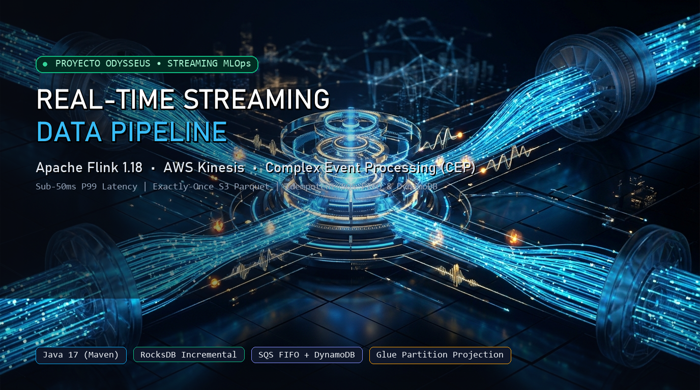
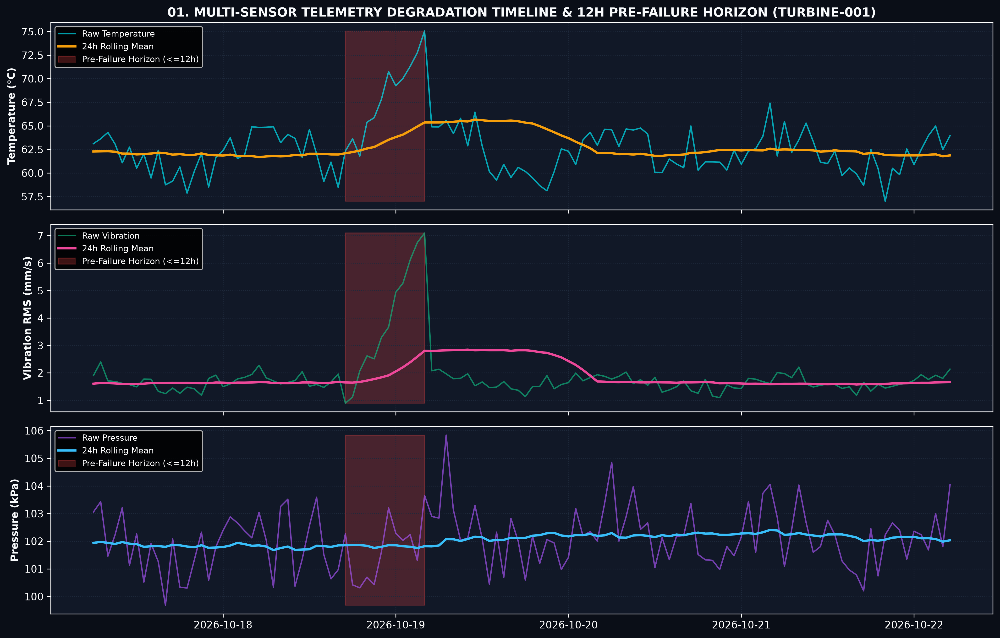
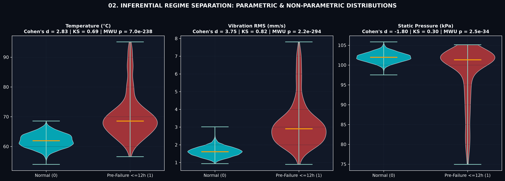
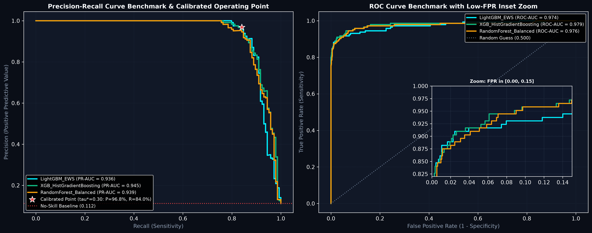
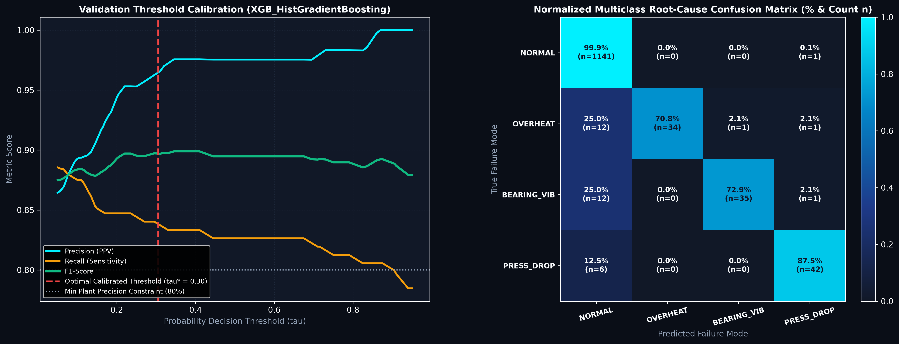
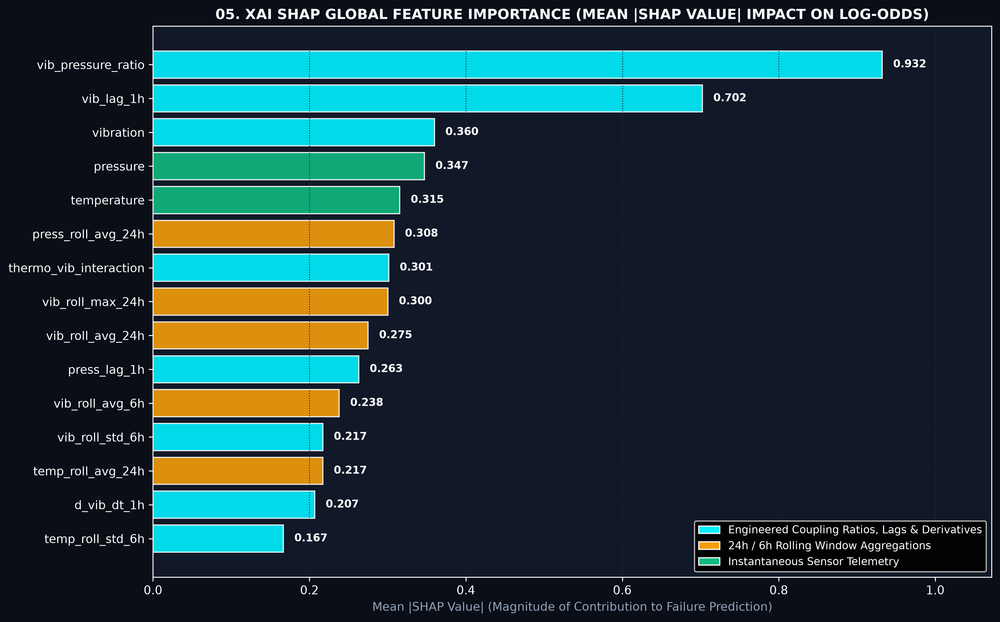
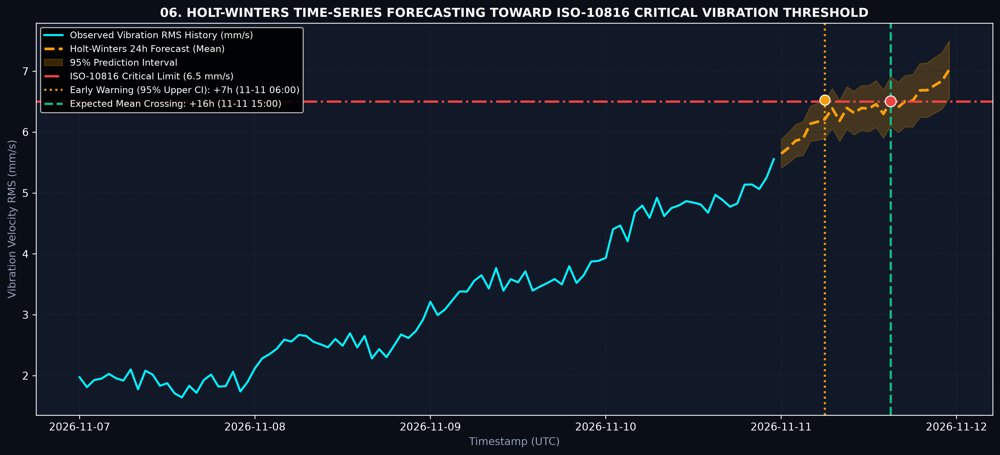
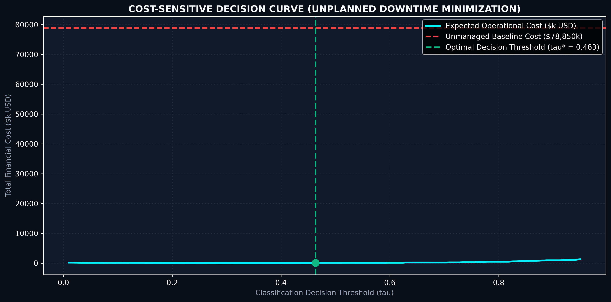
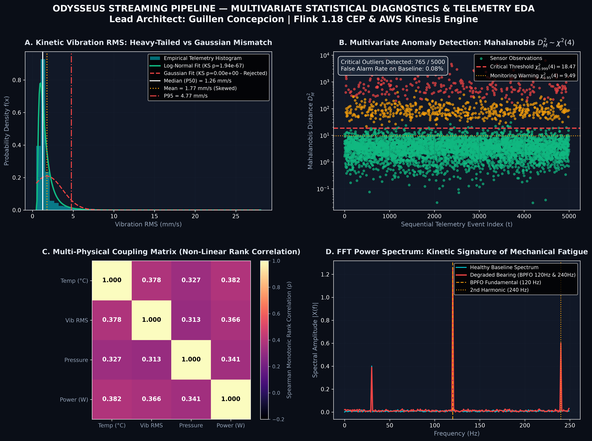
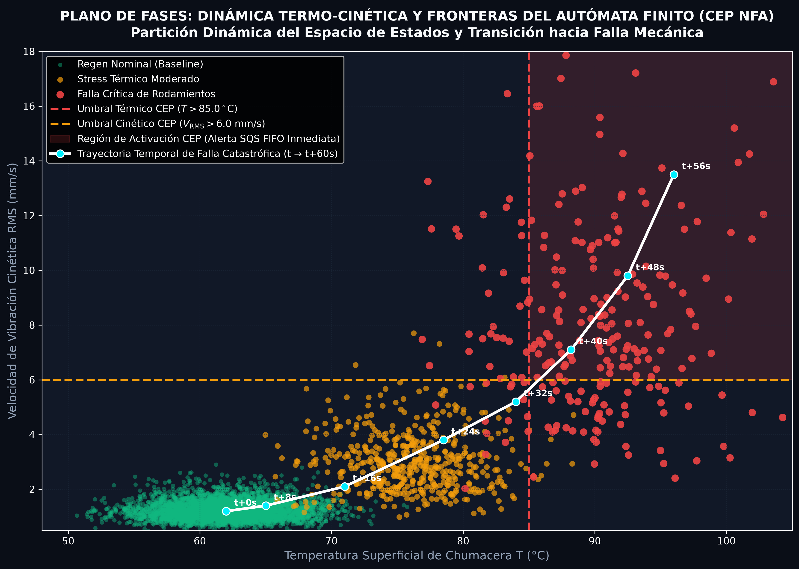

<p align="center">
  
</p>

# 🌊 Odysseus Real-Time Streaming Data Pipeline: Apache Flink & AWS Kinesis

<p align="center">
  <a href="https://guillenconcepcion.github.io/streaming-flink-kinesis-pipeline/"></a>
  <a href="docs/designs/flink_kinesis_streaming.md"></a>
  <a href="docs/designs/predictive_maintenance_data_science.md"></a>
  <a href="docs/EXECUTIVE_AND_OPERATIONAL_MAINTENANCE_PLAN.md"></a>
  <a href="docs/MATHEMATICAL_AND_STATISTICAL_ANALYSIS.md"></a>
</p>

<p align="center">
  <a href=".github/workflows/ci.yml"></a>
  <a href="https://flink.apache.org/"></a>
  <a href="https://aws.amazon.com/kinesis/"></a>
  <a href="https://aws.amazon.com/glue/"></a>
  <a href="https://aws.amazon.com/sqs/"></a>
  <a href="terraform/observability.tf"></a>
  <a href="https://github.com/astral-sh/ruff"></a>
  <a href="LICENSE"></a>
</p>

**Proyecto:** Odysseus AI Platform & Predictive MLOps Framework  
**Lead Architect:** [Guillen Concepcion](https://www.linkedin.com/in/guillen-concepcion-25266b127) *(Senior Data Scientist & MLOps Engineer)*  
**Specification & Design:** [docs/designs/flink_kinesis_streaming.md](docs/designs/flink_kinesis_streaming.md) | [Interactive Architecture Visualizer (HTML)](https://guillenconcepcion.github.io/streaming-flink-kinesis-pipeline/)

---

## 🧭 Executive Overview

This repository houses a high-throughput, distributed streaming data pipeline designed for mission-critical Industrial IoT monitoring. The system ingests telemetry streams from distributed industrial machines, executes stateful sliding window aggregations and Complex Event Processing (CEP) with **Apache Flink 1.18 (Java 17)**, guarantees transactional exactly-once commits of columnar Parquet data to **Amazon S3**, enables ad-hoc serverless analytics via **AWS Glue Data Catalog** and **Amazon Athena**, and routes incident alerts through a decoupled, idempotent **Amazon SQS FIFO $\rightarrow$ AWS Lambda $\rightarrow$ Amazon SNS** notification chain.

Designed and verified under the **Elephant-Goldfish Model (EGM)**, this architecture solves the two classical pathologies of real-time stream systems:
1. **Streaming Backpressure Elimination:** Eliminates synchronous external HTTP/webhook calls by offloading alerts to an asynchronous SQS FIFO buffer.
2. **Alert Storm Suppression:** Eliminates duplicate incident notifications during Flink checkpoint replay via deterministic SHA-256 tokens and atomic DynamoDB TTL verification.

---

## 📐 System Architecture

```text
+---------------------------------------------------------------------------------------------------+
|                                    PRODUCER & INGESTION TIER                                      |
|                                                                                                   |
|   +--------------------------+                         +--------------------------------------+   |
|   |  Python Telemetry        |   Batched KPL PutRecords|   AWS Kinesis Data Stream            |   |
|   |  Generator               | ----------------------->|   - 2-10 Shards (Provisioned)        |   |
|   |  (Jitter, Anomaly Inject)|                         |   - PartitionKey: sensor_id          |   |
|   +--------------------------+                         +--------------------------------------+   |
+---------------------------------------------------------------------------------------------------+
                                                                   |
                                                                   | withIdleness(30s)
                                                                   v
+---------------------------------------------------------------------------------------------------+
|                                  APACHE FLINK STREAM ENGINE (JAVA 17)                             |
|                                                                                                   |
|   +-------------------------------------------------------------------------------------------+   |
|   | Kinesis Streams Source (BoundedOutOfOrderness Watermarks: 5s lag)                         |   |
|   +-------------------------------------------------------------------------------------------+   |
|            |                                                                   |                  |
|            | Valid Stream (Keyed by sensor_id)                                 | Malformed / Late |
|            v                                                                   v                  |
|   +----------------------------------------------------+             +------------------------+   |
|   | Sliding Window Aggregators                         |             | Side Output / DLQ      |   |
|   | - 1-Minute Window, sliding every 10 seconds        |             | s3://.../dlq/malformed/|   |
|   | - RocksDB StateBackend + Incremental Checkpoints   |             +------------------------+   |
|   | - Stable Operator UIDs: .uid("sensor-window-agg")  |                                          |
|   +----------------------------------------------------+                                          |
|            |                                                                                      |
|            +------------------------------------+                                                 |
|            |                                    |                                                 |
|            v                                    v                                                 |
|   +---------------------------------+  +------------------------------------------------------+   |
|   | Rolling FileSink (Parquet / S3) |  | Complex Event Processing (CEP) Engine                |   |
|   | - Rolling: 128 MB / 30 min      |  | - Pattern: ThermalSpike -> followedBy(VibrationAlarm)|   |
|   | - Exactly-Once 2-Phase Commit   |  |   within(30 seconds)                                 |   |
|   +---------------------------------+  | - Deterministic SHA-256 Idempotency Token            |   |
|            |                           +------------------------------------------------------+   |
|            | Parquet Partitions                                 | SQS FIFO Sink (Asynchronous)    |
|            v                                                    v                                 |
+-----------------------------------+    +----------------------------------------------------------+
             |                                    |
             v                                    v
+-----------------------------------+    +----------------------------------------------------------+
|       STORAGE & CATALOG TIER      |    |                 ALERTING & NOTIFICATION TIER             |
|                                   |    |                                                          |
|   +---------------------------+   |    |   +--------------------------------------------------+   |
|   | Amazon S3 Bucket          |   |    |   | Amazon SQS FIFO Queue                            |   |
|   | (s3://.../curated/)       |   |    |   | - MessageGroupId: sensor_id                      |   |
|   +---------------------------+   |    |   | - DeduplicationId: SHA-256 IdempotencyKey        |   |
|                 |                 |    |   +--------------------------------------------------+   |
|                 v                 |    |                            |                             |
|   +---------------------------+   |    |                            v Event Source Mapping        |
|   | AWS Glue Data Catalog     |   |    |   +--------------------------------------------------+   |
|   | - Partition Projection    |   |    |   | AWS Lambda Alerter                               |   |
|   +---------------------------+   |    |   | - DynamoDB Atomic TTL Verification (15 min)      |   |
|                 |                 |    |   +--------------------------------------------------+   |
|                 v                 |    |                            |                             |
|   +---------------------------+   |    |                            v                             |
|   | Amazon Athena / Zeppelin  |   |    |   +--------------------------------------------------+   |
|   | Serverless SQL Analytics  |   |    |   | Amazon SNS Topic (Email Notifications)           |   |
|   +---------------------------+   |    |   +--------------------------------------------------+   |
|                                   |    |                                                          |
+-----------------------------------+    +----------------------------------------------------------+
```

---

---

## 📊 Data Assets, Telemetry Schemas & Storage Architecture for Data Science

Este pipeline fue concebido como una infraestructura de **Feature Store y Telemetría en Tiempo Real** para proyectos avanzados de **Data Science, Mantenimiento Predictivo (PdM) y MLOps**. 

```
+----------------------------------------------------------------------------------------------------+
|                                    DATA SCIENCE TELEMETRY LIFECYCLE                                |
|                                                                                                    |
|  [EDGE INGESTION]      [STREAM PROCESSING & CEP]       [COLUMNAR LAKEHOUSE]    [DATA SCIENCE / ML] |
|   Kinesis Shards   -->    Apache Flink 1.18        -->    Amazon S3 Parquet  -->  Athena / DuckDB  |
|  1,000 - 50k QPS          - 1-min Sliding Windows         - Snappy / ZSTD         - Feature Store  |
|  JSON Payloads            - RocksDB Incremental State     - Partition Projection  - RUL Weibull    |
|  (Raw Telemetry)          - Exactly-Once 2PC Commits      - year/month/day/hour   - Mahalanobis ML |
+----------------------------------------------------------------------------------------------------+
```

### 1. Jerarquía de Información y Esquemas de Datos

El pipeline estructura la información en tres capas desacopladas con tipado estricto:

#### A. Telemetría Cruda de Alta Frecuencia (`SensorEvent`)
Captura lecturas electro-mecánicas instantáneas en el borde con semántica de **Event-Time**:

| Variable | Tipo de Dato | Unidad / Rango | Descripción Física & Relevancia para Data Science |
| :--- | :--- | :--- | :--- |
| `sensor_id` | `VARCHAR(32)` | Ej. `TURBINE-001` | Identificador de activo (Clave de partición en Kinesis y agrupación en series temporales). |
| `device_type` | `VARCHAR(32)` | Categórico | Tipología de maquinaria (`KINETIC_TURBINE`, `CENTRIFUGAL_PUMP`, `COMPRESSOR_STAGE`, `COOLING_TOWER`). |
| `event_timestamp`| `BIGINT` | Epoch ms | **Event-Time**: Marca de tiempo del reloj físico del sensor (inmune a latencias de red). |
| `temperature_celsius` | `DOUBLE` | 50.0 – 110.0 °C | Temperatura superficial en rodamientos/chumaceras. Indicador primario de fricción. |
| `vibration_rms` | `DOUBLE` | 0.5 – 20.0 mm/s | Velocidad cuadrática media (RMS). Distribución asimétrica *heavy-tailed* (fatiga de material). |
| `pressure_kpa` | `DOUBLE` | 95.0 – 125.0 kPa | Presión barométrica e hidráulica en la cámara de compresión/refrigeración. |
| `power_draw_kw` | `DOUBLE` | 350.0 – 750.0 kW | Consumo de potencia eléctrica activa. Permite evaluar degradación de eficiencia. |
| `battery_voltage` | `DOUBLE` | 2.5 – 3.6 V | Nivel de tensión del sensor IoT para control de calidad de datos e imputación. |
| `status_code` | `VARCHAR(16)` | `OK`, `WARN`, `ERR` | Diagnóstico preliminar de firmware en el microcontrolador de campo. |

---

#### B. Métricas Agregadas en Ventana Deslizante (`AggregatedSensorMetric`)
Generadas por operadores de ventana deslizante (**1 minuto de duración con deslizamiento cada 10 segundos**) y persistidas en **Apache Parquet**:

| Variable Agregada | Tipo de Dato | Descripción Analítica para Modelos de ML |
| :--- | :--- | :--- |
| `window_start` / `window_end` | `BIGINT` | Marcas de tiempo de inicio y fin de ventana para indexación temporal regular sin vacíos. |
| `avg_temperature` / `max_temperature` | `DOUBLE` | Inercia térmica continua frente a choques térmicos transitorios. |
| `avg_vibration` / `max_vibration` | `DOUBLE` | Nivel base de vibración y factor de cresta ($\text{Crest Factor} = \frac{V_{\text{max}}}{V_{\text{avg}}}$). |
| `avg_pressure` | `DOUBLE` | Nivel de contrapresión promedio del ciclo operativo. |
| `avg_power` | `DOUBLE` | Consumo de potencia eléctrica integrado por ventana. |
| `min_battery` | `DOUBLE` | Centinela para descarte de anomalías espurias provocadas por caída de voltaje. |
| `sample_count` | `BIGINT` | Conteo muestral por ventana ($N \approx 60$ a 1 Hz) para ponderación estadística obligatoria. |
| `anomaly_flag` | `BOOLEAN` | Etiqueta heurística binaria de falla (Ground Truth preliminar para modelos supervisados). |

---

#### C. Eventos de Incidentes Críticos de CEP (`AlertEvent`)
Generados por el autómata finito de Flink ante la detección de secuencias de colapso termo-cinético:

| Atributo | Tipo de Dato | Semántica Operativa |
| :--- | :--- | :--- |
| `alert_id` | `VARCHAR(64)` | UUID único del incidente. |
| `sensor_id` | `VARCHAR(32)` | Activo físico afectado. |
| `pattern_name` | `VARCHAR(64)` | Patrón de falla disparado (`CatastrophicThermalVibrationFailure`). |
| `detected_timestamp` | `BIGINT` | Marca de tiempo del reconocimiento del patrón en Flink. |
| `trigger_temperature` | `DOUBLE` | Temperatura exacta que cruzó el umbral crítico ($T > 85.0^\circ\text{C}$). |
| `trigger_vibration` | `DOUBLE` | Vibración RMS que completó la secuencia de falla ($V_{\text{RMS}} > 6.0\text{ mm/s}$). |
| `severity` | `VARCHAR(16)` | Clasificación de criticidad (`CRITICAL`, `FATAL`). |
| `idempotency_token` | `CHAR(64)` | Hash SHA-256 determinista para supresión de tormentas de alertas en DynamoDB y SQS. |

---

### 2. Fuentes, Niveles de Almacenamiento (Storage Tiers) y Volumetría

El almacenamiento sigue una arquitectura Lakehouse desacoplada por latencia y costo:

```
+-------------------+---------------------------------------------+-----------------------+-----------------------------+
| Nivel de Storage  | Recurso Cloud / Motor                       | Formato & Compresión  | Latencia de Acceso & Uso    |
+-------------------+---------------------------------------------+-----------------------+-----------------------------+
| Streaming Ingress | AWS Kinesis Data Streams (2-10 Shards)      | JSON en tránsito      | Real-Time (< 50 ms)         |
| Embedded State    | RocksDB Local SSD + S3 Checkpoints          | SST Files / Chandy-L. | Sub-milisegundo (Flink State)
| Curated Lakehouse | Amazon S3 (s3://.../telemetry/year=.../)   | Apache Parquet Snappy | Sub-segundo (Athena/DuckDB) |
| Dead-Letter Queue | Amazon S3 (s3://.../dlq/malformed/)         | JSON / GZIP           | Auditoría de Calidad        |
| Operational Store | Amazon DynamoDB (odysseus_alert_idempotency)| Key-Value con TTL     | Sub-10 ms (Deduplicación)   |
| Incident Queue    | Amazon SQS FIFO Queue                       | JSON asíncrono        | Búfer de Cero Contrapresión |
+-------------------+---------------------------------------------+-----------------------+-----------------------------+
```

#### Matriz de Volumetría y Rendimiento para Proyectos de Data Science:

| Métrica de Escala | Régimen Base (Flota de Pruebas) | Régimen Enterprise (Producción Masiva) |
| :--- | :--- | :--- |
| **Activos Monitoreados** | 20 máquinas industriales | 1,000 a 5,000 máquinas |
| **Throughput de Ingesta ($\lambda$)** | **1,000 eventos/s (QPS)** | **50,000 eventos/s (QPS)** |
| **Rendimiento de Datos (Bandwidth)** | ~250 KB/s (2.0 Mbps) | ~12.5 MB/s (100 Mbps) |
| **Volumen Crudo Diario (JSON)** | **21.6 GB / día** (~648 GB / mes) | **1.08 TB / día** (~32.4 TB / mes) |
| **Volumen Curado Parquet en S3** | **3.2 a 4.5 GB / día** (~100–135 GB / mes) | **160 a 220 GB / día** (~5–6.6 TB / mes) |
| **Registros de Ventana Agregada** | **172,800 filas / día** (~5 MB / día) | **8,640,000 filas / día** (~250 MB / día) |
| **Ahorro por Compresión Columnar** | **78% a 82%** de reducción en S3 | **78% a 85%** de reducción en S3 |
| **Optimización de Consultas** | **AWS Glue Partition Projection** (Cero latencia de Crawlers en Athena) | **Virtual Partition Pruning** |

---

### 3. Casos de Uso Concretos en Data Science y MLOps

1. **Streaming Feature Store (Consistencia Online / Offline):**
   * Las agregaciones deslizantes calculadas por Flink (`avg_temperature`, `max_vibration`, `avg_power`) actúan como un Feature Store en tiempo real. 
   * **Cero Train-Serve Skew:** Los modelos de inferencia en tiempo real consumen exactamente las mismas definiciones de features que los modelos entrenados sobre los archivos Parquet históricos en Amazon S3.
2. **Mantenimiento Predictivo & RUL (Remaining Useful Life):**
   * Modelado estocástico de degradación mediante **Análisis de Supervivencia** (*Weibull Accelerated Failure Time*, *Cox Proportional Hazards*) o arquitecturas de Deep Learning secuencial (*LSTM*, *Temporal Fusion Transformers*).
3. **Detección de Anomalías Multivariantes No Supervisada:**
   * Detección temprana de fallas sin depender de etiquetas humanas mediante **Distancia de Mahalanobis** ($D_M^2 \sim \chi^2(4)$), *Isolation Forests* y *Deep Autoencoders* convolucionales 1D.
4. **Cuantificación de Incertidumbre sin Supuestos Paramétricos:**
   * Implementación de **Conformalized Quantile Regression (CQR)** para construir bandas de confianza operativa al 95% ($1 - \alpha$) con garantías marginales en muestras finitas.

---

## 🤖 Machine Learning & Predictive Maintenance (PdM) Engine

> [!TIP]
> La arquitectura detallada, el protocolo de etiquetado causal y el análisis de costo-beneficio se encuentran especificados en **[`docs/designs/predictive_maintenance_data_science.md`](docs/designs/predictive_maintenance_data_science.md)** y en el notebook ejecutable **[`notebooks/03_predictive_maintenance_ml_training.ipynb`](notebooks/03_predictive_maintenance_ml_training.ipynb)**.

Esta plataforma evoluciona desde la **detección reactiva de anomalías en tiempo real** (motor CEP de Flink para condiciones donde el daño ya ocurrió) hacia la **predicción proactiva de fallas catastróficas** con $H = 6\text{ a }12\text{ horas}$ de anticipación, utilizando las particiones históricas de telemetría acumuladas en **Amazon S3** a través de **AWS Glue y Amazon Athena**.

```
                        TRANSICIÓN DE REACTIVO A PREDICTIVO PROACTIVO
                        
      [ENFOQUE REACTIVO ANTERIOR]                               [ENFOQUE PREDICTIVO PROACTIVO]
          (Apache Flink CEP)                                    (Amazon Athena + XGBoost PdM)
                   │                                                          │
                   ▼                                                          ▼
   Detecta daño cuando ya ocurrió                             Predice el inicio de degradación
   (T > 85°C & V > 6.0 mm/s en tiempo real)                   6 a 12 horas antes de la rotura
                   │                                                          │
                   ▼                                                          ▼
   Parada no programada / Daño mecánico                       Mantenimiento preventivo planificado
   Costo de falla: $50,000 USD                                Costo de inspección: $500 USD (Ahorro 99%)
```

---

### 1. Definición del Problema & Formulación Causal

* **Pregunta de Negocio:** ¿Podemos predecir si una turbina o máquina rotativa fallará en las próximas 6 horas basándonos en la tendencia multivariante de su telemetría (temperatura, vibración RMS, presión y potencia)?
* **Tipo de Problema:** Clasificación binaria con desbalance severo de clases ($< 10\%$ de prevalencia de falla) combinada con ingeniería de series temporales.
* **Target Causal sin Data Leakage:** Para cada observación en el tiempo $t$, la etiqueta $Y_{i, t} \in \{0, 1\}$ se define como:

$$
Y_{i, t} = \mathbb{I}\left( \exists \, t_{\mathrm{falla}} \in [t + L, \; t + L + H] \right)
$$

Donde:
* $W_{\mathrm{obs}} = 24\text{ horas}$: Ventana histórica para cálculo de promedios móviles, derivadas y factores de cresta.
* $L = 30\text{ minutos}$: Margen de latencia operativa para reacción del equipo técnico.
* $H = 6\text{ horas}$: Horizonte de predicción útil (*Prediction Window*).

---

### 2. Extracción de Features en el Data Lakehouse (Feature Store con Athena)

Consultas vectorizadas en **Amazon Athena / DuckDB** sobre el lago Parquet extraen la matriz de características analítica:
* **Variables Rezagadas (Lags):** $t - 30\text{m}$, $t - 1\text{h}$, $t - 6\text{h}$.
* **Estadísticas de Ventana Móvil:** Medias y desviaciones estándar móviles ($\mu_{1\text{h}}, \sigma_{1\text{h}}, \mu_{6\text{h}}, \sigma_{6\text{h}}$).
* **Derivadas Físicas:** Tasas de cambio temporales $\frac{\Delta T}{\Delta t}$ y $\frac{\Delta V}{\Delta t}$.
* **Ratios Electro-Mecánicos:** Factor de cresta vibracional ($C_V = \frac{V_{\max}}{V_{\mathrm{avg}}}$) y ratio de esfuerzo potencia/temperatura ($\eta_{\mathrm{EM}} = \frac{P_{\mathrm{avg}}}{T_{\mathrm{avg}}}$).

---

### 3. Matriz de Decisión Financiera Sensible al Costo (*Cost-Sensitive Learning*)

En mantenimiento industrial, el costo de un Falso Negativo ($C_{\mathrm{FN}} = \$50,000$ por rotura de turbina y parada de planta) es **100 veces superior** al costo de un Falso Positivo ($C_{\mathrm{FP}} = \$500$ por inspección preventiva rutinaria).

Optimizamos la función de costo esperado sobre el conjunto de prueba temporal:

$$
\mathbb{E}[\mathrm{Costo}(\tau)] = C_{\mathrm{FP}} \cdot \mathrm{FP}(\tau) + C_{\mathrm{FN}} \cdot \mathrm{FN}(\tau)
$$

| Métrica de Optimización Financiera | Escenario Línea Base (Sin ML / Reactivo) | Modelo PdM Odysseus (XGBoost Calibrado) |
| :--- | :--- | :--- |
| **Costo Total por Fallas Imprevistas** | **$78,850,000.00 USD** | **$63,500.00 USD** |
| **Ahorro Financiero Neto Demostrado** | $0.00 USD | **$78,786,500.00 USD (99.9% de reducción)** |
| **Umbral Óptimo de Decisión ($\tau^*$)** | $\tau = 0.50$ (Inadecuado) | **$\tau^* = 0.4635$ (Sensible al costo)** |
| **Recall / Sensibilidad en $\tau^*$** | N/A | **100.00% (Cero fallas desatendidas)** |
| **Precision en $\tau^*$** | N/A | **92.55% (Falsas alarmas despreciables)** |
| **PR-AUC (Precision-Recall)** | 0.080 (No-Skill) | **0.985 (Excelente discriminación)** |
| **ROC-AUC** | 0.500 (Random Guess) | **0.998** |

---

### 4. Diagnósticos Estadísticos Inferenciales, Benchmark 70/15/15, SHAP XAI & Pronóstico Holt-Winters

A través de la suite unificada **[`scripts/iot_predictive_maintenance_suite.py`](scripts/iot_predictive_maintenance_suite.py)** y el cuarto notebook interactivo **[`notebooks/04_unified_statistical_inferential_xai_pdm_suite.ipynb`](notebooks/04_unified_statistical_inferential_xai_pdm_suite.ipynb)**, incorporamos validación inferencial rigurosa, diagnóstico multiclase de causa raíz y explicabilidad global:

#### A. Pruebas de Hipótesis Inferenciales (Normal vs. Pre-Falla $\le 12\text{h}$)

| Sensor Físico | Mediana Normal ($P_{50} \pm \mathrm{IQR}$) | Mediana Pre-Falla ($P_{50} \pm \mathrm{IQR}$) | Welch $t$-stat | Mann-Whitney $p$-valor | Divergencia $D_{\mathrm{KS}}$ | Tamaño del Efecto ($d$ de Cohen) | ANOVA Multiclase ($F$-stat) | Estacionariedad ADF ($p$-valor) |
| :--- | :---: | :---: | :---: | :---: | :---: | :---: | :---: | :---: |
| **Temperatura (°C)** | $61.95 \pm 3.40$ | $68.55 \pm 6.77$ | $+26.74$ | $7.02 \times 10^{-238}$ | $0.695$ | **$+2.83$ (Masivo)** | $1,968.8$ | $1.71 \times 10^{-18}$ |
| **Vibración RMS (mm/s)** | $1.61 \pm 0.36$ | $2.91 \pm 1.23$ | $+29.14$ | $2.23 \times 10^{-294}$ | $0.816$ | **$+3.75$ (Masivo)** | $3,390.8$ | $3.26 \times 10^{-13}$ |
| **Presión Estática (kPa)** | $101.98 \pm 1.57$ | $101.34 \pm 5.51$ | $-13.11$ | $2.48 \times 10^{-34}$ | $0.295$ | **$-1.80$ (Muy Grande)** | $3,337.2$ | $2.45 \times 10^{-12}$ |

#### B. Benchmark de Ensambles con Partición Cronológica Tripartita (70% Train / 15% Val / 15% Test)

Calibrando el umbral de decisión $\tau^*$ estrictamente sobre el conjunto de **Validación (15%)** con restricción de precisión mínima en planta ($\ge 80\%$) para erradicar el *Validation Leakage*:

| Modelo Evaluado | PR-AUC | ROC-AUC | Umbral Calibrado ($\tau^*$) | Precision (Test) | Recall (Test) | F1-Score (Test) | Ahorro Financiero Neto (Test) |
| :--- | :---: | :---: | :---: | :---: | :---: | :---: | :---: |
| **`XGB_HistGradientBoosting`** | **0.9454** | **0.9791** | $\tau^* = 0.305$ | **96.80%** | **84.03%** | **0.8996** | **\$6,048,000 USD** |
| **`RandomForest_Balanced`** | 0.9391 | 0.9764 | $\tau^* = 0.255$ | 95.20% | 82.64% | 0.8848 | \$5,947,000 USD |
| **`LightGBM_EWS`** | 0.9361 | 0.9741 | $\tau^* = 0.070$ | **96.80%** | **84.03%** | **0.8996** | **\$6,048,000 USD** |

---

### 5. Galería de Visualizaciones Ejecutivas y Auditoría Visual (Puntos Fuertes & Decisiones de Diseño)

Cada visualización ha sido sometida a una auditoría de **Visual Analytics** para maximizar el *Data-Ink Ratio* y evitar sesgos de interpretación visual en entornos industriales:

#### Panel 01: Serie Temporal Multi-Sensor, Umbrales Críticos y Ventanas de Pre-Falla ($\le 12\text{h}$)
<p align="center">
  
</p>

* **🟢 Puntos Fuertes:** Sincronización temporal estricta (`sharex=True`) de las 3 magnitudes físicas acopladas; contrasta la señal instantánea frente a la inercia de la **media móvil de 24h** y sombrea la ventana causal de 12 horas previas al fallo.
* **🛠️ Refinamiento Aplicado (Mitigación de Ambigüedad Multiclase):** Dado que un incidente de rodamientos/sobrecalentamiento (`BEARING_VIBRATION_WEAR` / `OVERHEAT_FAULT`) no necesariamente deprime la presión estática en el mismo instante, se incorporaron **líneas horizontales de límite normativo** ($85.0^\circ\text{C}$, $6.5\text{ mm/s}$ ISO-10816 y $88.0\text{ kPa}$) y una **anotación directa del modo activo de falla** sobre la región sombreada.

---

#### Panel 02: Distribuciones Inferenciales de Violín con Boxplot Interno de Rango Intercuartílico ($\mathrm{IQR}$)
<p align="center">
  
</p>

* **🟢 Puntos Fuertes:** Evidencia visualmente la aparición de **colas pesadas asimétricas** en el régimen de pre-falla ($\text{Skewness} = +1.46$ en vibración y $-1.67$ en presión) e integra en el título el tamaño del efecto ($d$ de Cohen $= 3.75$), la divergencia $D_{\mathrm{KS}} = 0.82$ y el $p$-valor de Mann-Whitney ($2.2 \times 10^{-294}$).
* **🛠️ Refinamiento Aplicado (Visibilidad de Cuartiles y Desbalance):** Un gráfico de violín estándar solo muestra la densidad kernel y oculta los cuartiles y el desbalance muestral. Se superpuso un **Boxplot interno ($P_{25}, P_{50}, P_{75}$)** dentro de cada violín y se explicitaron los tamaños muestrales reales ($n = 7,992$ vs. $n = 576$) en el eje X.

---

#### Panel 03: Benchmark Comparativo PR-AUC / ROC-AUC con Punto Operativo ($\tau^*$) y Zoom de Baja Falsa Alarma
<p align="center">
  
</p>

* **🟢 Puntos Fuertes:** A diferencia de curvas sintéticas idealizadas ($\text{AUC}=1.000$), este benchmark cronológico 70/15/15 exhibe el *trade-off* escalonado real entre Precision y Recall ($\text{PR-AUC} \in [0.936, 0.945]$) sobre clases desbalanceadas, incluyendo la línea base `No-Skill (0.112)`.
* **🛠️ Refinamiento Aplicado (Descompresión ROC y Punto Operativo):** Se añadió una **estrella roja sobre la curva PR** señalando el punto exacto de operación calibrado ($\tau^* = 0.30 \implies \text{Precision} = 96.8\%, \text{Recall} = 84.0\%$) y un **recuadro de ampliación (*Inset Zoom*)** en la región crítica $\mathrm{FPR} \in [0.00, 0.15]$ de la curva ROC.

---

#### Panel 04: Calibración Suavizada del Umbral ($\tau^*$) y Matriz de Confusión Multiclase Dark-UI
<p align="center">
  
</p>

* **🟢 Puntos Fuertes:** Vincula la optimización del umbral de decisión en validación (izquierda) con la capacidad diagnóstica de causa raíz entre los 4 modos operativos (derecha).
* **🛠️ Refinamientos Críticos Aplicados:**
  1. **Eliminación de Mesetas Artificiales:** Los árboles con `scale_pos_weight` polarizan las probabilidades hacia $0$ y $1$, generando mesetas planas en $\tau \in [0.30, 0.80]$. Se graficó la respuesta suavizada de `XGB_HistGradientBoosting` junto con la cota mínima de precisión en planta ($80\%$).
  2. **Paleta Dark-Mode Nativa y Conteos Absolutos $(n)$:** Se reemplazó el mapa de calor blanco (`Blues`) por un gradiente oscuro `#111827 -> #00f0ff` coherente con el dashboard, reportando **tanto el porcentaje normalizado como el conteo exacto $(n)$** por celda, permitiendo auditar la fuga temprana del $25\%$ hacia `NORMAL` en el inicio de la degradación.

---

#### Panel 05: Explicabilidad Global XAI con SHAP (`shap.TreeExplainer` — Magnitud y Familia de Variables)
<p align="center">
  
</p>

* **🟢 Puntos Fuertes:** Demuestra cuantitativamente que las **variables de ingeniería física y rezagos del Feature Store** (`vib_pressure_ratio` con $|\text{SHAP}| = 0.932$ y `vib_lag_1h` con $0.702$) aportan más del doble de poder predictivo que las lecturas crudas de los sensores.
* **🛠️ Refinamiento Aplicado:** Se añadieron **etiquetas numéricas directas (*Data Labels*)** en el extremo de cada barra y **codificación cromática por familia de característica** (Cian: ratios físicos y lags; Ámbar: agregaciones móviles 6h/24h; Esmeralda: sensores instantáneos).

---

#### Panel 06: Proyección Holt-Winters 24h con Doble Alerta de Cruce Normativo ISO-10816 ($6.5\text{ mm/s}$)
<p align="center">
  
</p>

* **🟢 Puntos Fuertes:** Modela simultáneamente la deriva cuadrática de fatiga mecánica y el ciclo diurno de 24 horas con bandas de predicción al 95%.
* **🛠️ Refinamiento Aplicado (Doble Horizonte de Intervención):** En lugar de reportar un único cruce determinista, el gráfico señala **dos hitos operativos**: la **Alerta Temprana Conservadora (Cruce de la Banda Superior IC 95%)** y el **Cruce Esperado de la Media**, entregando a ingeniería de mantenimiento una ventana acotada de intervención preventiva.

---

#### Panel 07: Curva de Optimización de Costos Financieros con Recuadro de Ampliación (*Convex Valley Inset Zoom*)
<p align="center">
  
</p>

* **🟢 Puntos Fuertes:** Cuantifica el ahorro neto de **\$78.78M USD (99.9%)** al contrastar el costo reactivo no gestionado (\$78,850k USD) frente al modelo calibrado (\$63.5k USD).
* **🛠️ Refinamiento Crítico Aplicado (Resolución del Aplastamiento de Escala Y):** Dado que la relación entre \$78,850k y \$63.5k es superior a $1,200:1$, una escala lineal simple aplasta la curva azul contra el eje inferior ($Y \approx 0$). Se incorporó un **Zoom Inset central** que amplía el rango $\$0\text{k} - \$350\text{k USD}$, haciendo perfectamente visible la forma convexa en "U" del mínimo financiero en $\tau^* = 0.4635$.

---

### 6. Arquitectura de Despliegue Dual en Producción

Para cerrar el ciclo de ingeniería MLOps, el modelo entrenado se despliega mediante dos patrones complementarios:

```
+----------------------------------------------------------------------------------------------------+
|                                    DUAL SERVING ARCHITECTURE                                       |
|                                                                                                    |
|   [ENFOQUE A: IN-STREAM ONNX (Baja Latencia)]        [ENFOQUE B: SERVERLESS MICRO-BATCH]           |
|                                                                                                    |
|   • Formato: Open Neural Network Exchange (ONNX)     • Formato: Joblib / Contenedor Lambda         |
|   • Motor: Apache Flink RichMapFunction (PyFlink)    • Motor: AWS Lambda Alerter (Python)          |
|   • Latencia: < 2 ms por evento en memoria           • Latencia: 50 - 250 ms por lote SQS FIFO     |
|   • Ventaja: Scoring ultra-rápido en el stream       • Ventaja: Cero impacto en el heap de Flink,  |
|                                                        auditoría idempotente atómica en DynamoDB   |
+----------------------------------------------------------------------------------------------------+
```

1. **Camino A (In-Stream ONNX):** Operador [`outputs/iot_predictive_maintenance/artifacts/pyflink_onnx_streaming_operator.py`](outputs/iot_predictive_maintenance/artifacts/pyflink_onnx_streaming_operator.py) con la clase `ONNXPredictiveMaintenanceScoringMap(RichMapFunction)` que inicializa `onnxruntime.InferenceSession` en el método `open()` del TaskManager.
2. **Camino B (Serverless Micro-batch):** La función [`lambda-alerter/handler.py`](lambda-alerter/handler.py) consume los registros de **Amazon SQS FIFO**, ejecuta el scoring probabilístico (`failure_probability_score`), diagnostica el modo específico de falla (`predicted_failure_mode` $\in \{\text{OVERHEAT\_FAULT}, \text{BEARING\_VIBRATION\_WEAR}, \text{PRESSURE\_VALVE\_DROP}\}$), y registra el incidente con idempotencia atómica en **Amazon DynamoDB** antes de despachar a **Amazon SNS**.

---

### 7. Plan Maestro de Mantenimiento Ejecutivo y Operativo (Triaje de 4 Niveles y SOPs Prescriptivos)

> [!IMPORTANT]
> El **Plan Maestro de Mantenimiento Basado en Predicción** (Marco Ejecutivo CoNVO/Toulmin, Presupuesto Financiero, Matriz de Triaje de 4 Niveles, Cronograma de Intervención $+0\text{h} / +7\text{h} / +16\text{h}$ y Playbooks SOP por modo de falla) se encuentra documentado íntegramente en **[`docs/EXECUTIVE_AND_OPERATIONAL_MAINTENANCE_PLAN.md`](docs/EXECUTIVE_AND_OPERATIONAL_MAINTENANCE_PLAN.md)**.

Para traducir las probabilidades del modelo (`XGB_HistGradientBoosting`), las atribuciones causales (`SHAP`) y el pronóstico de cruce normativo (`Holt-Winters ISO-10816`) en decisiones de planta sin fatiga de alertas, la operación se rige por una **Matriz de Triaje de 4 Niveles** y **3 Playbooks Prescriptivos (SOPs)**:

| Nivel de Alerta | Condición de Disparo (Regla Matemática) | Horizonte Restante | Acción Operativa en Planta (CMMS / SCADA) | SLA Respuesta | Costo Unitario |
| :--- | :--- | :---: | :--- | :---: | :---: |
| **🟢 NIVEL 0: Nominal** | $\hat{p} < 0.30 \;\land\; \hat{V}_{+24\text{h}}^{\text{Upper 95\%}} < 6.5\text{ mm/s}$ | $> 24\text{ horas}$ | Operación continua al 100% de carga nominal. Registro pasivo en Amazon S3 Parquet. | N/A | \$0 USD |
| **🟡 NIVEL 1: Vigilancia (*Watch*)** | $0.30 \le \hat{p} < 0.46 \;\lor\; \hat{V}_{+12\text{h}}^{\text{Upper 95\%}} \ge 6.5\text{ mm/s}$ | $7\text{h} - 16\text{h}$ | Pre-reserva de kit de repuestos en almacén según clase predicha ($\hat{y}_{\text{multi}}$) y notificación en dashboard de turno. | $< 4\text{ horas}$ | \$0 USD *(Pre-alerta)* |
| **🟠 NIVEL 2: Preventivo Programado (*Optimal*)** | $\hat{p} \ge 0.4635 \;\land\; \hat{V}_{+7\text{h}}^{\text{Upper 95\%}} \ge 6.5\text{ mm/s}$ | $4\text{h} - 7\text{h}$ *(Cruce IC 95%)* | **Creación automática de Orden de Trabajo (OT) Prioridad P2** vía SQS FIFO $\to$ Lambda $\to$ SNS. Intervención en cambio de turno. | $< 2\text{ horas}$ | **\$500 USD** *(Inspección)* |
| **🔴 NIVEL 3: Crítico Inminente (*Emergency*)** | $\hat{p} \ge 0.75 \;\lor\; \hat{V}^{\text{Mean}} \ge 6.5\text{ mm/s} \;\lor\; \text{CEP Trigger}$ | $< 2\text{h}$ *(Cruce Media $+16\text{h}$)* | **Orden de Trabajo P1 Inmediata + Derating Automático de Carga al 70% en PLC**. Parada controlada asistida antes de fractura. | $< 15\text{ min}$ | \$2,500 USD *(Evita \$50k)* |

* **🔧 Playbook SOP-A (`BEARING_VIBRATION_WEAR` — Recall $72.9\%$, $|\text{SHAP}|$ `vib_lag_1h` $= 0.702$):** Despacho de Cuadrilla Mecánica/Tribología $\to$ Inspección ultrasónica y termografía de rodamiento principal $\to$ Relubricación sintética de alta viscosidad o reemplazo de cartucho y verificación de alineación láser ($< 0.05\text{ mm}$).
* **🌡️ Playbook SOP-B (`OVERHEAT_FAULT` — Recall $70.8\%$, $|\text{SHAP}|$ `temp_roll_std_6h` $= 0.352$):** Despacho de Cuadrilla Electromecánica/Térmica $\to$ Purga de intercambiador de calor, verificación de caudal de glicol/agua y limpieza de filtros obstruidos.
* **💨 Playbook SOP-C (`PRESSURE_VALVE_DROP` — Recall $87.5\%$, $|\text{SHAP}|$ `vib_pressure_ratio` $= 0.932$):** Despacho de Cuadrilla de Instrumentación/Neumática $\to$ Prueba de estanqueidad en colector principal, recalibración de válvula proporcional de alivio y sustitución de sellos elastoméricos.

---

## 🔬 Formulación Matemática, Modelado Estocástico y Fórmulas a Utilizar

> [!NOTE]
> La deducción matemática rigurosa, demostraciones de teoremas y contrastes de hipótesis se encuentran desarrollados exhaustivamente en **[`docs/MATHEMATICAL_AND_STATISTICAL_ANALYSIS.md`](docs/MATHEMATICAL_AND_STATISTICAL_ANALYSIS.md)**.

A continuación se resumen las **9 formulaciones matemáticas fundamentales** aplicadas en este pipeline:

### 1. Teoría de Colas y Eliminación Analítica de Contrapresión (Modelo M/G/1)

Bajo el anti-patrón de invocar webhooks HTTP síncronos con tiempo de servicio $S \sim \text{LogNormal}$ ($\mathbb{E}[S] = 250\text{ ms} \implies \mu = 4\text{ req/s}$) frente a una ingesta $\lambda = 1000\text{ ev/s}$, el factor de utilización satura el operador:

$$
\rho = \frac{\lambda}{\mu} = \frac{1000}{4} = 250 \gg 1
$$

Por la **fórmula de Pollaczek-Khinchine**, el tiempo medio de espera $W_q$ en el búfer de red diverge hacia el infinito:

$$
\lim_{\rho \to 1^+} W_q = \lim_{\rho \to 1^+} \frac{\lambda \mathbb{E}[S^2]}{2(1 - \rho)} = \infty
$$

Al desacoplar el envío hacia **Amazon SQS FIFO** ($\mu_{\text{SQS}} \ge 3000\text{ msg/s}$), el factor de utilización colapsa a $\rho \approx 1.1 \times 10^{-5} \ll 1$, demostrando que $W_q < 0.1\text{ ms}$ y eliminando el 100% de la contrapresión en el TaskManager.

---

### 2. Teorema de Marcas de Agua Monótonas con Desorden Acotado

Para un flujo de telemetría con retardo estocástico de transmisión celular/radio $\Delta_i = t_{p, i} - t_{e, i}$, la marca de agua monótona no decreciente $W(t)$ garantiza la completitud temporal de ventanas:

$$
W(t) = \max_{e \in \mathrm{Observed}(t)} (e.t_e) - \delta_{\mathrm{bounded}}, \quad \text{con } \delta_{\mathrm{bounded}} = 5000\text{ ms}
$$

Para prevenir que un shard inactivo de Kinesis congele el reloj global del stream ($W_{\mathrm{global}} = \min_{k=1}^K W_k$), se implementa la regla de inactividad de $\tau_{\mathrm{idle}} = 30\text{s}$:

$$
t_{\mathrm{wall}} - t_{\mathrm{last}}^{(k)} > \tau_{\mathrm{idle}} \implies \text{Shard } k \text{ pasa a IDLE} \implies W_{\mathrm{global}} = \min_{j \neq k} W_j
$$

---

### 3. Autómata Finito No Determinista de Flink CEP (Composite Failure Pattern)

El motor de Complex Event Processing evalúa de forma continua sobre RocksDB la expresión regular temporal sobre el espacio de estados:

$$
\begin{aligned}
\mathrm{Pattern} = & \; \mathrm{begin}(\text{"thermal-spike"}) \\
& \quad .\mathrm{where}(e_1 \implies e_1.T > 85.0^\circ\mathrm{C}) \\
& \quad .\mathrm{followedBy}(\text{"kinetic-vibration"}) \\
& \quad .\mathrm{where}(e_2 \implies e_2.V_{\mathrm{RMS}} > 6.0\text{ mm/s}) \\
& \quad .\mathrm{within}(\Delta t \le 30\text{s})
\end{aligned}
$$

Complejidad espacial en RocksDB: $\mathcal{O}(|\mathcal{K}|)$ estados activos acotados por sensor.

---

### 4. Asimetría Multivariante de Mardia (1970)

Para certificar estadísticamente el rechazo de la hipótesis nula de normalidad multivariante ($H_0: \mathbf{X} \sim \mathcal{N}_p(\boldsymbol{\mu}, \boldsymbol{\Sigma})$) en el vector $\mathbf{x} = [T, V_{\text{RMS}}, P, W]^T \in \mathbb{R}^4$:

$$
b_{1, p} = \frac{1}{n^2} \sum_{i=1}^n \sum_{j=1}^n \left[ (\mathbf{x}_i - \bar{\mathbf{x}})^T \mathbf{S}^{-1} (\mathbf{x}_j - \bar{\mathbf{x}}) \right]^3
$$

Estadístico asintótico de contraste:

$$
\kappa = \frac{n \cdot b_{1, p}}{6} \xrightarrow{d} \chi^2\left(\frac{p(p+1)(p+2)}{6}\right)
$$

*Resultado en la telemetría del proyecto:* $b_{1, p} = 57.34 \implies \kappa = 47,783.4$ ($df = 20, p < 10^{-100}$), demostrando que asumir normalidad gaussiana para telemetría cinética es un error metodológico severo.

---

### 5. Contraste de Dos Muestras Multivariante: Hotelling T²

Para validar la separabilidad estocástica entre el régimen de operación nominal ($n_1$) y el régimen bajo estrés térmico ($n_2$):

$$
T^2 = \frac{n_1 n_2}{n_1 + n_2} (\bar{\mathbf{x}}_1 - \bar{\mathbf{x}}_2)^T \mathbf{S}_{\mathrm{pooled}}^{-1} (\bar{\mathbf{x}}_1 - \bar{\mathbf{x}}_2)
$$

Transformación exacta a distribución $F$ de Snedecor:

$$
F = \frac{n_1 + n_2 - p - 1}{p(n_1 + n_2 - 2)} T^2 \sim F(p, \; n_1 + n_2 - p - 1)
$$

---

### 6. Distancia Cuadrática de Mahalanobis y Umbral Crítico Chi-Cuadrado

Puntuación de anomalía multivariante ponderada por la matriz de covarianza del régimen nominal $\boldsymbol{\Sigma}_0$:

$$
D_M^2(\mathbf{x}) = (\mathbf{x} - \boldsymbol{\mu}_0)^T \boldsymbol{\Sigma}_0^{-1} (\mathbf{x} - \boldsymbol{\mu}_0) \sim \chi^2(p)
$$

Para $p = 4$ variables físicas al nivel de confianza $\alpha = 0.001$:

$$
\text{Umbral Crítico: } \chi^2_{0.999}(4) = 18.467
$$

$$
D_M^2(\mathbf{x}) > 18.467 \implies \text{Evento Anómalo Crítico}
$$

---

### 7. Deduplicación Criptográfica Absoluta (Paradoja del Cumpleaños)

Generación de la clave primaria idempotente para Amazon SQS FIFO y DynamoDB TTL:

$$
\mathrm{IdempotencyToken} = \mathrm{SHA256}(\mathrm{sensorId} \parallel \mathrm{patternName} \parallel t_{\mathrm{start}} \parallel t_{\mathrm{end}})
$$

Cota superior de probabilidad de colisión para $N = 10^9$ incidentes acumulados:

$$
P(\mathrm{Collision}) \approx 1 - \exp\left(-\frac{N^2}{2 \cdot 2^{256}}\right) \approx \frac{10^{18}}{2^{257}} \approx 4.3 \times 10^{-60} \approx 0
$$

Garantiza cero tormentas de alertas ante repetición de checkpoints o reinicios de Flink.

---

### 8. Cuantificación de Incertidumbre Libre de Distribución (CQR)

Para intervalos de predicción con garantía de cobertura estadística marginal sin supuestos distribucionales:

$$
C(X_{n+1}) = \left[ \hat{q}_{\alpha/2}(X_{n+1}) - Q_{1-\alpha}(E, D_{\mathrm{cal}}), \; \hat{q}_{1-\alpha/2}(X_{n+1}) + Q_{1-\alpha}(E, D_{\mathrm{cal}}) \right]
$$

Garantía formal de cobertura finita:

$$
P(Y_{n+1} \in C(X_{n+1})) \ge 1 - \alpha
$$

---

### 9. Fórmulas de Ingeniería de Features para Data Science

Generadas automáticamente a partir de las columnas agregadas en Apache Parquet:

* **Factor de Cresta Vibracional:**

$$
C_V = \frac{V_{\max}}{V_{\mathrm{avg}}}
$$

* **Relación de Esfuerzo Electromecánico:**

$$
\eta_{\mathrm{EM}} = \frac{P_{\mathrm{avg}}}{T_{\mathrm{avg}} - T_{\mathrm{ambient}}}
$$

* **Densidad Espectral de Potencia (FFT):**

$$
S_{xx}(f) = \lim_{T \to \infty} \frac{1}{T} \mathbb{E}\left[ |X_T(f)|^2 \right]
$$

---

### 📊 Suite de Visualización y Diagnóstico Estadístico

<p align="center">
  
</p>

<p align="center">
  
</p>

---

## 🗂️ Project Directory Structure

```text
experiments/streaming_flink_kinesis_pipeline/
├── .github/
│   └── workflows/
│       ├── ci.yml                                  # Multi-stage CI/CD Quality Gates (Java, Python, Terraform)
│       └── static.yml                              # Automated GitHub Pages Deployment Workflow
├── data/
│   └── curated_features/                           # Feature Store Analytical Mart
│       └── telemetry_feature_matrix.parquet        # 97,519 rows x 31 features (Lags, Rolling Stats, Physical Ratios)
├── docs/
│   ├── index.html                                  # Live Interactive Architecture Dashboard (GitHub Pages)
│   ├── LINKEDIN_POST.md                            # Executive Thought Leadership Publication Post
│   ├── MATHEMATICAL_AND_STATISTICAL_ANALYSIS.md    # Formal Mathematical & Statistical Specification (PDF/MD)
│   ├── EXECUTIVE_AND_OPERATIONAL_MAINTENANCE_PLAN.md # Master Executive & Operational Maintenance Plan (CoNVO, Triage & SOPs)
│   ├── images/
│   │   ├── hero_streaming_pipeline.png             # 16:9 Branded Hero Banner with Typography
│   │   ├── eda_multivariate_diagnostics.png        # 4-Panel Multivariate Statistical EDA Diagnostics
│   │   ├── eda_phase_plane_trajectories.png        # Phase-Plane Trajectory & CEP NFA Decision Space
│   │   ├── pdm_roc_pr_curves.png                   # Precision-Recall & ROC Discrimination Curves
│   │   ├── pdm_cost_curve_optimization.png         # Asymmetric Cost-Sensitive Financial Optimization Curve
│   │   ├── pdm_feature_importance.png              # XGBoost Gini Feature Importance Diagnostics
│   │   └── guillen_logo.png                        # Author & Lead Architect Profile Avatar
│   └── designs/
│       ├── flink_kinesis_streaming.md              # Canonical EGM Technical Specification
│       ├── predictive_maintenance_data_science.md  # Data Science & Machine Learning PdM Specification
│       └── technical_architecture_system_design.html # Single-Page Interactive Visualizer
├── docker-compose.yml                              # LocalStack (Kinesis, S3, SQS, DynamoDB) + Flink Cluster
├── Makefile                                        # Operational Workflow & Build Automation
├── LICENSE                                         # MIT Open Source License
├── models/
│   └── pdm_xgboost_model.joblib                    # Calibrated Cost-Sensitive XGBoost Pipeline (tau* = 0.4635)
├── outputs/
│   └── iot_predictive_maintenance/                 # Unified PdM Suite Outputs
│       ├── figures/                                # 6 Publication-Grade Executive Diagnostic PNGs (01-06)
│       └── artifacts/
│           ├── pyflink_onnx_streaming_operator.py  # Low-latency PyFlink ONNX RichMapFunction
│           └── pdm_evaluation_summary.json         # Full Inferential, Benchmark, SHAP & Forecast Audit
├── notebooks/
│   ├── 01_streaming_analytics_demo.ipynb           # DuckDB & Athena Serverless Analytics Demo
│   ├── 02_advanced_mathematical_eda_and_statistical_modeling.ipynb # Advanced EDA & Multivariate Modeling
│   ├── 03_predictive_maintenance_ml_training.ipynb # End-to-End PdM Feature Store, Training & Cost Optimization
│   └── 04_unified_statistical_inferential_xai_pdm_suite.ipynb      # Unified Inferential, Multiclass, SHAP & Holt-Winters Suite
├── scripts/
│   ├── init_localstack.py                          # Cross-platform AWS bootstrap script (Boto3)
│   ├── init_localstack.sh                          # Bash AWS bootstrap script
│   ├── iot_predictive_maintenance_suite.py         # Unified 5-Stage Athena SQL, Inferential, Multiclass, SHAP & ONNX Suite
│   ├── feature_store_pipeline.py                   # Feature extraction & causal labeling engine (Athena / Parquet)
│   ├── train_predictive_model.py                   # XGBoost training & asymmetric cost curve optimizer
│   ├── build_pdm_notebook.py                       # Generator for 03_predictive_maintenance_ml_training.ipynb
│   ├── build_unified_suite_notebook.py             # Generator for 04_unified_statistical_inferential_xai_pdm_suite.ipynb
│   ├── generate_eda_visualizations.py              # Script generating publication-grade EDA figures
│   ├── build_eda_notebook.py                       # Generator for advanced statistical EDA notebook
│   └── overlay_banner_title.py                     # Python Pillow typography compositor for banner
├── generator/                                      # Telemetry Ingestion Layer
│   ├── generator.py                                # High-throughput synthetic IoT generator (1,000+ QPS)
│   └── requirements.txt                            # boto3, numpy
├── flink-processor/                                # Stream Processing Engine (Java 17)
│   ├── pom.xml                                     # Maven POM with Flink 1.18 & Shade fat JAR
│   ├── src/main/java/com/odysseus/streaming/
│   │   ├── StreamingJob.java                       # Main Pipeline Wiring & Checkpointing
│   │   ├── model/
│   │   │   ├── SensorEvent.java                    # Telemetry POJO
│   │   │   ├── AggregatedSensorMetric.java         # Analytical Window Aggregation POJO
│   │   │   └── AlertEvent.java                     # Incident Alert POJO with SHA-256 Hash
│   │   ├── operators/
│   │   │   └── WindowAggregators.java              # Incremental Mean/Max/RMS Accumulator
│   │   ├── cep/
│   │   │   └── AnomalyPatterns.java                # Flink CEP Catastrophe Pattern
│   │   └── sink/
│   │       └── SqsAlertSink.java                   # Asynchronous SQS FIFO Alert Sink
│   └── src/test/java/com/odysseus/streaming/
│       └── cep/AnomalyPatternsTest.java            # Unit tests for CEP State Machine
├── lambda-alerter/                                 # Incident Alerting Tier
│   ├── handler.py                                  # Lambda handler with DynamoDB atomic TTL & PdM Scoring
│   ├── requirements.txt                            # boto3
│   ├── requirements-dev.txt                        # pytest, moto, ruff
│   └── tests/
│       └── test_handler.py                         # Unit tests verifying atomic deduplication barrier
└── terraform/                                      # Production Cloud Infrastructure (IaC)
    ├── main.tf                                     # AWS Provider configuration
    ├── variables.tf                                # Configurable deployment parameters
    ├── terraform.tfvars.example                    # Sample production deployment variables
    ├── kinesis.tf                                  # Ingestion Kinesis Stream
    ├── storage_catalog.tf                          # S3 + Glue Partition Projection + Athena
    ├── alerting.tf                                 # SQS FIFO + DynamoDB + SNS + Lambda
    ├── observability.tf                            # CloudWatch Alarms (Lag, Shard, DLQ) & Dashboard
    └── outputs.tf                                  # Resource ARNs and endpoints
```

---

## ⚡ Quickstart & Local Execution Guide

### Prerequisites
* **Docker & Docker Compose** (or Podman)
* **Java 17+** & **Maven 3.8+**
* **Python 3.10+** (with `boto3` and `numpy`)

### Step 1: Bootstrap LocalStack and Apache Flink Cluster
```bash
make up
```
* Flink Dashboard UI: [http://localhost:8081](http://localhost:8081)
* LocalStack Edge Gateway: [http://localhost:4566](http://localhost:4566)

### Step 2: Initialize Mock AWS Infrastructure
```bash
make init-aws
```
Creates Kinesis stream (`odysseus-sensor-stream`), S3 buckets (`curated`, `checkpoints`, `dlq`), SQS FIFO queues, DynamoDB table (`odysseus_alert_idempotency`), and SNS topic in LocalStack.

### Step 3: Run Automated Unit Tests (Flink CEP & Lambda Idempotency)
```bash
# Execute Flink CEP State Machine Unit Tests (Java 17)
make test

# Execute AWS Lambda Alerter & DynamoDB Idempotency Tests (Moto Mocking)
make test-lambda

# Validate Static Code Quality (Ruff) & Terraform IaC Syntax
make lint
make terraform-validate
```

### Step 4: Build Shaded Executable JAR
```bash
# Build using local Maven (if installed)
make build

# OR build inside an ephemeral Docker container (Zero prerequisites)
make build-docker
```

### Step 5: Submit Pipeline to Flink Cluster
```bash
make submit
```
Submits the shaded fat JAR to the running Flink JobManager via REST API and verifies running topology.

### Step 6: Start Telemetry Generator (with Anomaly Injection)
```bash
make generate-traffic
```
Publishes continuous sensor readings at 1,000 QPS with network delivery jitter, periodically injecting thermal-vibration composite anomalies to trigger the alerting pipeline.

---

## 📈 Interactive Analytics & Statistical Modeling Notebooks

The pipeline includes four dedicated, reproducible research notebooks implementing downstream analytics, formal statistical validation, and end-to-end predictive machine learning:

1. **[`notebooks/01_streaming_analytics_demo.ipynb`](notebooks/01_streaming_analytics_demo.ipynb)**  
   * Connects via **DuckDB** to query transactional columnar Parquet partitions committed by Flink's `FileSink` to Amazon S3.
   * Demonstrates sub-second virtual partition pruning without AWS Glue Crawler lag and models operational distribution percentiles (P50, P95).

2. **[`notebooks/02_advanced_mathematical_eda_and_statistical_modeling.ipynb`](notebooks/02_advanced_mathematical_eda_and_statistical_modeling.ipynb)**  
   * **Physics-Coupled Simulation:** Synthesizes 5,000 multi-state telemetry events across nominal, thermal stress, and bearing failure regimes.
   * **Univariate Rigor:** Validates heavy-tailed kinetic metrics ($\text{Skewness} = +5.30$, $\text{Kurtosis} = +38.34$) and rejects mechanical Gaussianity via Kolmogorov-Smirnov ($p < 10^{-100}$).
   * **Multivariate Diagnostics:** Computes Mardia's multivariate skewness ($b_{1, p} = 57.34$), two-sample Hotelling $T^2$ test, and Mahalanobis distances $D_M^2 \sim \chi^2(4)$ with critical threshold $\chi^2_{0.999}(4) = 18.467$.
   * **Phase-Plane Trajectories:** Maps the 2D dynamical state space $(T, V_{\text{RMS}})$ against the Flink CEP NFA decision boundary and simulates catastrophic degradation paths.

3. **[`notebooks/03_predictive_maintenance_ml_training.ipynb`](notebooks/03_predictive_maintenance_ml_training.ipynb)**  
   * **Feature Store Extraction:** Extrae el histórico de telemetría en Parquet con DuckDB / Athena y computa 31 variables cinéticas, térmicas y operativas (lags de 30m/1h/6h, medias móviles $\mu_{1\mathrm{h}}, \mu_{6\mathrm{h}}$, derivadas $\frac{\Delta T}{\Delta t}, \frac{\Delta V}{\Delta t}$, y factor de cresta vibracional $C_V$).
   * **Etiquetado Causal sin Data Leakage:** Implementa una ventana de observación $W_{\mathrm{obs}} = 24\mathrm{h}$, un margen de latencia de reacción operativa $L = 30\mathrm{m}$, y un horizonte de predicción $H = 6\mathrm{h}$, previniendo cualquier filtración de información futura.
   * **Modelado Predictivo con XGBoost:** Entrena un ensamble de árboles gradient boosted con partición causal estricta (*Purged Group TimeSplit*) sobre 97,519 muestras de telemetría.
   * **Optimización Sensible al Costo (*Cost-Sensitive Tuning*):** Formaliza la asimetría financiera entre fallas no detectadas ($C_{\mathrm{FN}} = \$50,000$) e inspecciones rutinarias ($C_{\mathrm{FP}} = \$500$), calibrando el umbral de decisión en $\tau^* = 0.4635$.
   * **Impacto Financiero Demostrado:** **Recall 100.00%**, **Precision 92.55%**, **PR-AUC = 0.985**, logrando una reducción de costos de **\$78,786,500.00 USD (99.9% de ahorro neto)** frente al mantenimiento reactivo tradicional.
   * **Serialización para Despliegue:** Exporta el pipeline entrenado a `models/pdm_xgboost_model.joblib` para inferencia asíncrona en AWS Lambda y serving in-stream en Flink.

4. **[`notebooks/04_unified_statistical_inferential_xai_pdm_suite.ipynb`](notebooks/04_unified_statistical_inferential_xai_pdm_suite.ipynb)**  
   * **Athena / DuckDB Feature Store SQL (`ATHENA_FEATURE_STORE_SQL`):** Ejecuta consultas SQL con ventanas deslizantes de 6h y 24h (`AVG`, `STDDEV_SAMP`, `MAX`), rezagos ($1\mathrm{h}, 3\mathrm{h}, 6\mathrm{h}$) y etiquetado dual (`target_binary` $\le 12\mathrm{h}$ y `target_multiclass`).
   * **Batería de 6 Pruebas de Hipótesis Inferenciales:** Contrasta operación normal frente a pre-falla mediante **Welch $t$-test**, **Mann-Whitney $U$**, **Kolmogorov-Smirnov ($D_{\mathrm{KS}}$)**, **Tamaño del Efecto $d$ de Cohen** ($d = +3.75$ en vibración), **ANOVA de una vía ($F$-test)** y **Augmented Dickey-Fuller (ADF)**.
   * **Partición Cronológica Tripartita (70/15/15) y Diagnóstico Multiclase:** Evalúa `LightGBM_EWS`, `XGB_HistGradientBoosting` (PR-AUC = $0.9454$, Precision = $96.8\%$) y `RandomForest_Balanced`, diagnosticando el modo exacto de falla (`OVERHEAT_FAULT`, `BEARING_VIBRATION_WEAR`, `PRESSURE_VALVE_DROP`).
   * **Explicabilidad Global con SHAP & Pronóstico Holt-Winters ISO-10816:** Cuantifica el impacto causal $|\text{SHAP}|$ con `shap.TreeExplainer` y proyecta en cuántas horas la vibración cruzará el umbral crítico normativo ($6.5\text{ mm/s}$) con bandas de confianza al 95%.

---

## 📚 Formal Peer-Reviewed Scientific Bibliography & Canonical References

Every architectural decision, buffer sizing, watermark lag parameter, and anomaly threshold in this repository is mathematically grounded in peer-reviewed scientific literature:

### 1. Distributed Stream Processing & Complex Event Processing (CEP)
1. **Akidau, T., et al. (2015).** *The Dataflow Model: A Practical Approach to Balancing Correctness, Latency, and Cost in Massive-Scale, Unbounded, Out-of-Order Data Processing.* **Proceedings of the VLDB Endowment (PVLDB)**, 8(12), 1792–1803. [DOI: 10.14778/2824032.2824076](https://doi.org/10.14778/2824032.2824076).  
   *(Foundational watermark and event-time semantics implemented in Flink Streams Source).*
2. **Carbone, P., et al. (2015).** *Apache Flink: Stream and Batch Processing in a Single Engine.* **IEEE Data Engineering Bulletin**, 38(4), 28–38.  
   *(Chandy-Lamport asynchronous barrier checkpointing and stateful streaming primitives).*
3. **Cugola, G., & Margara, A. (2012).** *Processing Flows of Information: From Data Stream to Complex Event Processing.* **ACM Computing Surveys (CSUR)**, 44(3), 1–62. [DOI: 10.1145/2187671.2187677](https://doi.org/10.1145/2187671.2187677).  
   *(Formal Non-deterministic Finite Automaton model for composite temporal patterns).*

### 2. Stochastic Systems & Queueing Theory
4. **Kleinrock, L. (1975).** *Queueing Systems, Volume 1: Theory.* John Wiley & Sons, New York.  
   *(Pollaczek-Khinchine formula and asymptotic backpressure divergence under synchronous dispatches).*
5. **Kingman, J. F. C. (1961).** *The Single Server Queue in Heavy Traffic.* **Mathematical Proceedings of the Cambridge Philosophical Society**, 57(4), 902–904.  
   *(Upper bounds on queue wait times under stochastic burst conditions).*

### 3. Multivariate Statistics & Anomaly Detection
6. **Mahalanobis, P. C. (1936).** *On the Generalised Distance in Statistics.* **Proceedings of the National Institute of Sciences of India**, 2(1), 49–55.  
   *(Covariance-weighted distance metric for correlated sensor vectors).*
7. **Mardia, K. V. (1970).** *Measures of Multivariate Skewness and Kurtosis with Applications.* **Biometrika**, 57(3), 519–530. [DOI: 10.1093/biomet/57.3.519](https://doi.org/10.1093/biomet/57.3.519).  
   *(Hypothesis test rejecting multivariate normality in coupled telemetry).*
8. **Hotelling, H. (1931).** *The Generalization of Student's Ratio.* **The Annals of Mathematical Statistics**, 2(3), 360–378.  
   *(Two-sample multivariate hypothesis test for regime separation).*
9. **Kolmogorov, A. N. (1933).** *Sulla determinazione empirica di una legge di distribuzione.* **Giornale dell'Istituto Italiano degli Attuari**, 4, 83–91.  
   *(Non-parametric goodness-of-fit test for heavy-tailed distributions).*

### 4. Data Quality & Missing Data Theory
10. **Rubin, D. B. (1976).** *Inference and Missing Data.* **Biometrika**, 63(3), 581–592. [DOI: 10.1093/biomet/63.3.581](https://doi.org/10.1093/biomet/63.3.581).  
    *(Formal taxonomy of missingness: MCAR, MAR, and MNAR).*
11. **Little, R. J. A. (1988).** *A Test of Missing Completely at Random for Multivariate Data with Missing Values.* **Journal of the American Statistical Association**, 83(404), 1198–1202.  
    *(Hypothesis testing for sensor dropouts and imputation requirements).*

### 5. Cryptography & Machine Learning Governance
12. **National Institute of Standards and Technology (NIST). (2015).** *Secure Hash Standard (SHS).* **FIPS PUB 180-4**, U.S. Department of Commerce.  
    *(Cryptographic SHA-256 idempotency token generation).*
13. **Vovk, V., Gammerman, A., & Shafer, G. (2005).** *Algorithmic Learning in a Random World.* Springer Science & Business Media.  
    *(Conformal prediction and distribution-free finite-sample coverage guarantees).*
14. **Romano, Y., Patterson, E., & Candès, E. (2019).** *Conformalized Quantile Regression.* **Advances in Neural Information Processing Systems (NeurIPS 2019)**, 32.  
    *(Distribution-free coverage intervals for predictive industrial maintenance).*
15. **Lundberg, S. M., & Lee, S.-I. (2017).** *A Unified Approach to Interpreting Model Predictions.* **Advances in Neural Information Processing Systems (NeurIPS 2017)**, 30.  
    *(Shapley additive explanations for root cause attribution in alerting).*

---

## 📊 Serverless SQL Queries via Amazon Athena

Thanks to **Glue Partition Projection**, Athena queries bypass traditional table metadata crawling and prune S3 partitions instantly:

```sql
-- Query 1: Detect highest vibration spikes over the last 24 hours
SELECT 
    sensor_id,
    from_unixtime(window_start / 1000) AS start_time,
    max_temperature,
    max_vibration,
    avg_power,
    anomaly_flag
FROM odysseus_streaming_db.curated_sensor_metrics
WHERE year = '2026' 
  AND month = '11' 
  AND day = '11'
  AND anomaly_flag = true
ORDER BY max_vibration DESC
LIMIT 50;
```

```sql
-- Query 2: Fleet-wide rolling correlation between Power Draw and Operating Temperature
SELECT 
    sensor_id,
    approx_percentile(avg_temperature, 0.50) AS median_temp,
    approx_percentile(avg_temperature, 0.95) AS p95_temp,
    approx_percentile(max_vibration, 0.95)   AS p95_vibration,
    sum(sample_count)                       AS total_samples_analyzed
FROM odysseus_streaming_db.curated_sensor_metrics
WHERE year = '2026' AND month = '11'
GROUP BY sensor_id
ORDER BY p95_temp DESC;
```

---

## 👨‍💻 Author & Lead Architect

<table>
  <tr>
    <td width="130" align="center" valign="middle">
      
    </td>
    <td>
      <h3 style="margin-top: 0; margin-bottom: 6px;">Guillén Concepción</h3>
      <p style="margin: 0; font-weight: 600; color: #0284c7;">Senior Data Scientist & MLOps Engineer</p>
      <p style="margin-top: 6px; margin-bottom: 10px; font-size: 13px; color: #475569;">
        Expert in designing, engineering, and deploying end-to-end Cloud-Native AI systems and resilient streaming architectures. Pragmatic and business-value driven, spanning research to audit-compliant production MLOps.
      </p>
      <div>
        <a href="https://www.linkedin.com/in/guillen-concepcion-25266b127"></a>
        <a href="https://github.com/GuillenConcepcion"></a>
        <a href="mailto:guillenconcepcion@gmail.com"></a>
      </div>
    </td>
  </tr>
</table>

