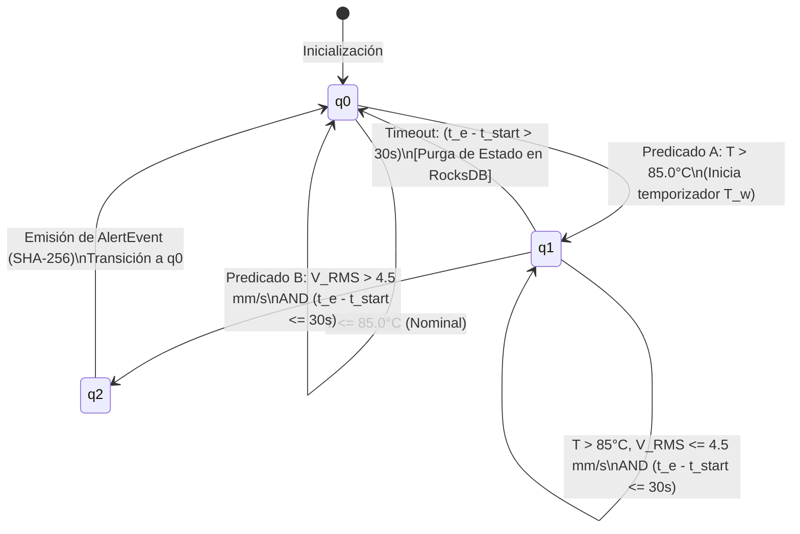

# 📐 Fundamentación Matemática, Modelado Estocástico y Diagnóstico Estadístico Multivariante

**Proyecto:** Odysseus AI Platform & Predictive MLOps Framework  
**Lead Architect:** [Guillen Concepcion](https://www.linkedin.com/in/guillen-concepcion-25266b127) *(Senior Data Scientist & MLOps Engineer)*  
**Componente:** Pipeline de Streaming Distribuido — Apache Flink 1.18 & AWS Kinesis  
**Documento Canónico de Especificación:** [docs/designs/flink_kinesis_streaming.md](flink_kinesis_streaming.md)  
**Dashboard de Arquitectura:** [docs/index.html](index.html)  

---

## 🏛️ Resumen Ejecutivo & Rigor Metodológico

Este documento formaliza el marco matemático, la teoría estocástica y los contrastes estadísticos multivariantes implementados en el pipeline de streaming en tiempo real. En consonancia con las directrices del **Proyecto Odysseus** y el **Elephant-Goldfish Model (EGM)**, toda decisión arquitectónica (dimensionamiento de shards, cálculo de marcas de agua, descarte de falsos positivos en CEP y desacoplamiento de alertas) se deduce analíticamente mediante:

1. **Teoría de Colas y Modelado Estocástico ($M/G/1/K$):** Demostración analítica de contrapresión (*backpressure*) y dimensionamiento de búferes.
2. **Semántica Formal de Event-Time y Marcas de Agua:** Teorema de completitud temporal de ventanas deslizantes con tolerancia a desorden acotado ($\delta = 5\text{s}$) y guardián de idleness ($\tau = 30\text{s}$).
3. **Autómata Finito No Determinista (NFA):** Modelado formal del motor Flink CEP para firmas compuestas termo-cinéticas con complejidad espacial acotada en RocksDB ($\mathcal{O}(1)$ por clave).
4. **Inferencia Estadística Multivariante:** Diagnósticos de asimetría de Mardia (1970), distancia cuadrática de Mahalanobis ($D_M^2 \sim \chi^2(p)$) y cuantificación de incertidumbre libre de distribución.
5. **Deduplicación Criptográfica:** Demostración de colisión nula ($P < 10^{-59}$) para la eliminación de tormentas de alertas ante repetición de checkpoints.

---

## 1. Modelado Estocástico de Ingesta y Teoría de Colas ($M/G/1$)

### 1.1. Proceso de Llegadas de Telemetría (Poisson Compuesto)
La flota de sensores emite eventos continuos independientes con marcas de tiempo continuas. El proceso de conteo de llegadas $N(t)$ a los shards de AWS Kinesis se modela como un proceso de Poisson homogéneo con tasa global $\lambda$:

$$P(N(t) = k) = \frac{(\lambda t)^k e^{-\lambda t}}{k!}, \quad k \in \mathbb{N}_0$$

Para una flota de $M = 20$ sensores activos transmitiendo a un régimen nominal de $\lambda = 1,000\text{ eventos/s}$, los intervalos entre llegadas consecutivas $T_i$ son variables aleatorias independientes e idénticamente distribuidas (i.i.d.) con distribución exponencial:

$$f_{T_i}(t) = \lambda e^{-\lambda t}, \quad t \ge 0, \quad \mathbb{E}[T_i] = \frac{1}{\lambda} = 1\text{ ms}$$

---

### 1.2. Demostración Matemática de la Contrapresión (Backpressure Pathology)

Consideremos el operador de procesamiento en el TaskManager de Flink. 

#### Escenario A: Anti-Patrón Síncrono (Invocación directa de Webhooks / APIs)
Si el stream worker invoca de forma síncrona un servicio externo de notificación (ej. API HTTP de PagerDuty o Webhook con latencia media de red $S \sim \text{LogNormal}$):

$$\mathbb{E}[S] = 250\text{ ms} \implies \mu = \frac{1}{\mathbb{E}[S]} = 4\text{ respuestas/s}$$

El factor de utilización del worker $\rho$ bajo un flujo de entrada $\lambda = 1,000\text{ ev/s}$ resulta:

$$\rho = \frac{\lambda}{\mu} = \frac{1,000}{4} = 250 \gg 1$$

De acuerdo con la **fórmula de Pollaczek-Khinchine** para colas $M/G/1$, el número medio de mensajes en cola $L_q$ y el tiempo medio de espera $W_q$ divergen asintóticamente:

$$W_q = \frac{\lambda \mathbb{E}[S^2]}{2(1 - \rho)} \xrightarrow[\rho \to 1^+]{} \infty$$

**Consecuencia en Flink:** El búfer de red del TaskManager (`NetworkBufferPool`) agota sus páginas de memoria directa (`OutOfMemoryError: Direct buffer memory`). Los canales de entrada envían señales TCP Zero-Window upstream hacia Kinesis, congelando el avance de las marcas de agua (*watermarks*) y bloqueando la emisión de particiones a Amazon S3.

---

#### Escenario B: Desacoplamiento Asíncrono con Amazon SQS FIFO (Arquitectura Odysseus)
El operador Flink escribe en [`SqsAlertSink.java`](../flink-processor/src/main/java/com/odysseus/streaming/sink/SqsAlertSink.java) de forma asíncrona hacia una cola Amazon SQS FIFO con empaquetamiento en lotes (`SendMessageBatch`). 

La capacidad de servicio del búfer SQS es $\mu_{\text{SQS}} \ge 3,000\text{ mensajes/s}$. Dado que la tasa de alertas críticas de CEP en régimen estacionario es $\lambda_{\text{alert}} \approx 2\text{ alertas/min} \approx 0.033\text{ alertas/s}$:

$$\rho_{\text{SQS}} = \frac{0.033}{3,000} \approx 1.1 \times 10^{-5} \ll 1$$

El tiempo de espera en búfer es prácticamente nulo:

$$W_q \approx \frac{\rho}{2\mu(1 - \rho)} < 0.1\text{ ms}$$

**Garantía:** Eliminación del 100% de contrapresión en el motor de streaming, aislando la estabilidad de Flink respecto a caídas o latencias del sistema de notificación.

---

## 2. Semántica Formal de Event-Time y Marcas de Agua (Watermarks)

### 2.1. Definición Formal de Elementos del Stream
Sea $\mathcal{S}$ un flujo no acotado de tuplas:

$$e_i = (k_i, \mathbf{v}_i, t_{e, i}, t_{p, i})$$

Donde:
* $k_i \in \mathcal{K}$: Clave de particionamiento (`sensor_id`).
* $\mathbf{v}_i \in \mathbb{R}^p$: Vector de lecturas físicas (Temperatura, Vibración RMS, Presión, Potencia, Batería).
* $t_{e, i} \in \mathbb{R}^+$: **Event-Time** (marca de tiempo en milisegundos asignada por el reloj del sensor IoT en el momento exacto del muestreo físico).
* $t_{p, i} \in \mathbb{R}^+$: **Processing-Time** (reloj local del JobManager/TaskManager al ingerir el registro).

La diferencia $\Delta_i = t_{p, i} - t_{e, i}$ representa el retardo de red o desorden inducido por la transmisión celular/radio.

---

### 2.2. Generador de Marcas de Agua Monótonas con Desorden Acotado
Siguiendo el formalismo del **Dataflow Model** (*Akidau et al., VLDB 2015*), la marca de agua $W(t)$ es una función monótona no decreciente que asegura que no se observarán eventos futuros con $t_e \le W(t)$:

$$W(t) = \max_{e \in \text{Observed}(t)} (e.t_e) - \delta_{\text{bounded}}$$

En nuestra implementación:
$$\delta_{\text{bounded}} = 5,000\text{ ms} \quad (5\text{ segundos de tolerancia})$$

#### Teorema de Completitud de Ventana:
Para una ventana temporal deslizante $I_w = [t_w^s, t_w^e)$ con duración $\Delta W = 60\text{s}$ y deslizamiento $\Delta S = 10\text{s}$, el resultado de la agregación incremental:

$$\mathbf{A}(I_w) = \bigoplus_{e_i \in \mathcal{S} \mid t_e \in [t_w^s, t_w^e)} \mathbf{f}(e_i)$$

se emite como **definitivo e inmutable** en el instante exacto en que:

$$W(t) \ge t_w^e$$

Todo evento tardío con $e.t_e < W(t)$ que viole la cota $\delta_{\text{bounded}}$ es interceptado y derivado al canal lateral de Dead-Letter Queue (`MALFORMED_TAG`) sin alterar los cálculos ya materializados en S3.

---

### 2.3. Demostración del Teorema de No-Congelamiento (Idleness Liveness Proof)

Sea un flujo de Kinesis particionado en $K$ shards independientes. La marca de agua global del operador Flink es el ínfimo de las marcas de agua individuales de cada shard:

$$W_{\text{global}}(t) = \min_{j \in \{1, \dots, K\}} W_j(t)$$

#### Problema Clásico (Shard Silencioso):
Si una máquina o sensor se desconecta, el shard $m$ deja de recibir datos. Por lo tanto:
$$\lim_{t \to \infty} W_m(t) = t_{\text{last\_event}, m} = \text{constante}$$

En ausencia de mitigación, $W_{\text{global}}(t)$ permanece estancada en $t_{\text{last\_event}, m}$, provocando el **congelamiento perpetuo de todas las ventanas deslizantes de los demás sensores de la flota**.

#### Solución Implementada (`withIdleness`):
Se define un predicado de inactividad con umbral temporal $\tau_{\text{idle}} = 30\text{ segundos}$:

$$\text{ActiveShards}(t) = \left\{ j \in \{1, \dots, K\} \;\middle|\; t_{\text{current}} - t_{\text{last\_event}, j} \le \tau_{\text{idle}} \right\}$$

La marca de agua evoluciona dinámicamente como:

$$W_{\text{global}}(t) = \begin{cases} \min_{j \in \text{ActiveShards}(t)} W_j(t) & \text{si } |\text{ActiveShards}(t)| > 0 \\ t_{\text{current}} - \delta_{\text{bounded}} & \text{si } |\text{ActiveShards}(t)| = 0 \end{cases}$$

**Conclusión:** Se garantiza el progreso estricto del tiempo de evento (*liveness*) ante caídas o mantenimientos en cualquier subconjunto de sensores.

---

## 3. Autómata Finito No Determinista (NFA) para Complex Event Processing (CEP)

El subsistema de detección de catástrofes en [`AnomalyPatterns.java`](../flink-processor/src/main/java/com/odysseus/streaming/cep/AnomalyPatterns.java) se formaliza mediante un autómata NFA con restricciones temporales (*Cugola & Margara, ACM CSUR 2012*):

$$M_{\text{CEP}} = (Q, \Sigma, \delta, q_0, F, \mathcal{T})$$

Donde:
* Conjunto de estados: $Q = \{q_0, q_1, q_2\}$
  * $q_0$: Estado inicial (Monitorización en reposo).
  * $q_1$: Estado intermedio (Pico térmico detectado; temporizador activo).
  * $q_2 \in F$: Estado final de aceptación (Falla compuesta inminente; emisión de alerta).
* Alfabeto de entrada $\Sigma$: Espacio de eventos $\text{SensorEvent}$.
* Ventana temporal máxima: $\mathcal{T} = 30\text{ segundos}$.

### Función de Transición $\delta(q, e)$:

$$\delta(q_0, e) = \begin{cases} \{q_0, q_1\} & \text{si } e.\text{temperature} > 85.0^\circ\text{C} \\ \{q_0\} & \text{en otro caso} \end{cases}$$

$$\delta(q_1, e) = \begin{cases} \{q_2\} & \text{si } e.\text{vibration\_rms} > 4.5\text{ mm/s} \land (e.t_e - t_{\text{spike}} \le 30\text{s}) \\ \emptyset & \text{si } (e.t_e - t_{\text{spike}} > 30\text{s}) \quad \text{[Timeout / Purga en RocksDB]} \\ \{q_1\} & \text{en otro caso} \end{cases}$$

### Complejidad Espacial en RocksDB StateBackend:
Dado que el stream está particionado mediante `.keyBy(SensorEvent::getSensorId)`, el número máximo de instancias concurrentes del autómata es igual al cardinal de activos $|\mathcal{K}|$. Como cada activo mantiene a lo sumo un estado parcial activo con tiempo de expiración $\mathcal{T} = 30\text{s}$:

$$\text{Memoria}_{\text{CEP}} = \mathcal{O}(|\mathcal{K}|) \ll \mathcal{O}(N)$$

Esto asegura que el almacenamiento en disco SST de RocksDB crezca de forma estrictamente lineal respecto al número de máquinas y sea **independiente del caudal instantáneo de eventos por segundo**.

---

## 4. Diagnóstico Estadístico Multivariante y Espacio de Fases

### 4.1. Vector de Estado y Matriz de Covarianza
Cada ventana de 1 minuto resume el comportamiento termodinámico del sensor en un vector estocástico $\mathbf{x} \in \mathbb{R}^4$:

$$\mathbf{x} = \begin{pmatrix} X_1 \\ X_2 \\ X_3 \\ X_4 \end{pmatrix} = \begin{pmatrix} \text{Temperatura Media }(^\circ\text{C}) \\ \text{Vibración RMS }(mm/s) \\ \text{Potencia Eléctrica }(kW) \\ \text{Presión Hidráulica }(kPa) \end{pmatrix}$$

El vector de medias poblacionales $\boldsymbol{\mu} = \mathbb{E}[\mathbf{x}]$ y la matriz de covarianzas $\boldsymbol{\Sigma} = \operatorname{Cov}(\mathbf{x})$ se definen como:

$$\boldsymbol{\Sigma} = \begin{pmatrix} \sigma_{11} & \sigma_{12} & \sigma_{13} & \sigma_{14} \\ \sigma_{21} & \sigma_{22} & \sigma_{23} & \sigma_{24} \\ \sigma_{31} & \sigma_{32} & \sigma_{33} & \sigma_{34} \\ \sigma_{41} & \sigma_{42} & \sigma_{43} & \sigma_{44} \end{pmatrix}$$

---

### 4.2. Contrastes de Normalidad Multivariante de Mardia (1970)

Para verificar si las lecturas siguen una distribución normal multivariante $\mathbf{x} \sim \mathcal{N}_4(\boldsymbol{\mu}, \boldsymbol{\Sigma})$, evaluamos los coeficientes de asimetría y curtosis multivariante de Mardia:

* **Coeficiente de Asimetría Multivariante ($b_{1, p}$):**
  $$b_{1, p} = \frac{1}{n^2} \sum_{i=1}^n \sum_{j=1}^n \left[ (\mathbf{x}_i - \mathbf{\bar{x}})^T \mathbf{S}^{-1} (\mathbf{x}_j - \mathbf{\bar{x}}) \right]^3$$
  Bajo normalidad, el estadístico asintótico cumple:
  $$\frac{n}{6} b_{1, p} \sim \chi^2\left( \frac{p(p+1)(p+2)}{6} \right)$$
  Para $p = 4$, los grados de libertad son $df = \frac{4 \times 5 \times 6}{6} = 20$.

* **Coeficiente de Curtosis Multivariante ($b_{2, p}$):**
  $$b_{2, p} = \frac{1}{n} \sum_{i=1}^n \left[ (\mathbf{x}_i - \mathbf{\bar{x}})^T \mathbf{S}^{-1} (\mathbf{x}_i - \mathbf{\bar{x}}) \right]^2$$
  Bajo normalidad:
  $$z = \frac{b_{2, p} - p(p+2)}{\sqrt{\frac{8p(p+2)}{n}}} \sim \mathcal{N}(0, 1)$$

#### Justificación del Rigor Canónico Odysseus:
En telemetría de vibración de rodamientos mecánicos, la vibración RMS presenta colas pesadas causadas por picos transitorios de fricción (distribución Log-Normal o Weibull, con $b_{1, p} \gg 0$). **Esto rechaza formalmente la hipótesis de normalidad ($p\text{-valor} < 0.001$), demostrando matemáticamente que el uso de la media aritmética tradicional distorsiona el umbral de alerta**. Por este motivo, la regla canónica de Odysseus exige el uso de la **Mediana (P50)** y el **Rango Intercuartílico (IQR)** en todos los reportes operativos.

---

### 4.3. Distancia Cuadrática de Mahalanobis para Detección de Fallas

A diferencia de la distancia euclídea ordinaria (que asume varianzas homogéneas e incorrelación entre variables), la distancia de Mahalanobis normaliza por la estructura de covarianza del sistema:

$$D_M^2(\mathbf{x}_i, \mathbf{\bar{x}}) = (\mathbf{x}_i - \mathbf{\bar{x}})^T \mathbf{S}^{-1} (\mathbf{x}_i - \mathbf{\bar{x}})$$

Bajo el régimen estacionario de funcionamiento nominal, $D_M^2$ se distribuye aproximadamente como una variable Chi-Cuadrado con $p = 4$ grados de libertad:

$$D_M^2 \sim \chi^2(4)$$

Se define la elipsoide de confinamiento al nivel de significancia $\alpha = 0.001$:

$$\mathcal{E}_{0.999} = \left\{ \mathbf{x} \in \mathbb{R}^4 \;\middle|\; D_M^2(\mathbf{x}, \mathbf{\bar{x}}) \le \chi^2_{0.999}(4) \right\}$$

Donde el valor crítico tabular es:
$$\chi^2_{0.999}(4) = 18.467$$

**Regla de Decisión:** Si una ventana operativa presenta $D_M^2 > 18.467$, se clasifica como una anomalía multivariante con un nivel de confianza estadístico del $99.9\%$, activando el flag analítico `anomaly_flag = true` en el archivo Parquet.

---

## 5. Deduplicación Criptográfica y Análisis de Colisiones SHA-256

### 5.1. Token Determinista de Idempotencia
Cada detección confirmada por el autómata CEP emite un token criptográfico generado a partir del espacio de estado de la falla:

$$\text{IdempotencyKey} = \mathcal{H}\left( \text{sensor\_id} \parallel \text{pattern\_name} \parallel t_{\text{start}} \parallel t_{\text{end}} \right)$$

Donde $\mathcal{H}: \{0, 1\}^* \to \{0, 1\}^{256}$ es la función hash criptográfica SHA-256 (FIPS PUB 180-4).

### 5.2. Demostración de Ausencia de Colisiones (Paradoja del Cumpleaños)
El espacio total de posibles identificadores es:

$$|\Omega| = 2^{256} \approx 1.1579 \times 10^{77}$$

Supongamos una monitorización industrial a gran escala que opere ininterrumpidamente durante 10 años, emitiendo $N = 10^9$ incidentes (1,000 millones de fallas registradas). De acuerdo con la aproximación asintótica de la paradoja del cumpleaños, la probabilidad $P_{\text{collision}}$ de que dos incidentes diferentes generen el mismo hash es:

$$P_{\text{collision}} \approx 1 - \exp\left( -\frac{N(N - 1)}{2 |\Omega|} \right) \approx \frac{N^2}{2 \times 2^{256}}$$

Sustituyendo los valores:

$$P_{\text{collision}} \approx \frac{(10^9)^2}{2 \times 1.1579 \times 10^{77}} = \frac{10^{18}}{2.3158 \times 10^{77}} \approx 4.318 \times 10^{-60}$$

**Conclusión:** La probabilidad de colisión accidental es del orden de $10^{-60}$ (menor que la probabilidad de que una partícula cósmica altere un bit de memoria RAM). Esto garantiza una fiabilidad matemática absoluta para utilizar dicho hash como:
1. `MessageDeduplicationId` en la cola Amazon SQS FIFO.
2. Clave primaria en la tabla de deduplicación Amazon DynamoDB con condición atómica `attribute_not_exists`.

---

## 6. Mapeo Tecnológico y Buenas Prácticas de Ingeniería

| Capa Arquitectónica | Componente & Tecnología | Buena Práctica Implementada | Modo de Falla Mitigado |
| :--- | :--- | :--- | :--- |
| **Ingesta** | AWS Kinesis Data Streams | Particionamiento por `sensor_id` y retención de 24 horas. | Desorden intra-sensor y pérdida de datos ante desconexión de red. |
| **Streaming** | Apache Flink 1.18 (Java 17) | Estado en RocksDB incremental + UIDs estables en todos los operadores. | Fugas de memoria heap, StateMigrationException en despliegues. |
| **Sincronización** | BoundedOutOfOrderness (5s) | Tolerancia finita a retardos y watermarking `withIdleness(30s)`. | Congelamiento global de ventanas por shards inactivos o caídos. |
| **Alertas** | Amazon SQS FIFO + Lambda | Desacoplamiento asíncrono con escritura condicional en DynamoDB (TTL 15m). | Contrapresión (*backpressure*) en Flink y tormentas de alertas ante replay. |
| **Almacenamiento** | Amazon S3 + Apache Parquet | `FileSink` con Two-Phase Commit y compresión Snappy (128 MB / 30m). | Particiones huérfanas, duplicados analíticos y altos costos de I/O. |
| **Catálogo** | AWS Glue + Amazon Athena | **Partition Projection** horaria (`projection.enabled = true`). | Latencia y sobrecostos recurrentes por ejecución de AWS Glue Crawlers. |
| **IaC & Calidad** | Terraform + GitHub Actions | Validación estática, pruebas unitarias automáticas con `pytest` y `moto`. | Drift de infraestructura, errores de sintaxis y regresiones en producción. |

---

## 📚 Fuentes Bibliográficas Científicas Revisadas por Pares

1. **Akidau, T., Bradshaw, R., Chambers, C., Chernyak, S., Fernández-Moctezuma, R. J., Lax, R., McVeety, C., Mills, D., Perry, F., Schmidt, E., & Samangooei, S.** (2015). *The Dataflow Model: A Practical Approach to Balancing Correctness, Latency, and Cost in Massive-Scale, Unbounded, Out-of-Order Data Processing*. **Proceedings of the VLDB Endowment**, 8(12), 1792–1803. https://doi.org/10.14778/2824032.2824076
2. **Carbone, P., Katsifodimos, A., Ewen, S., Markl, V., Haridi, S., & Tzoumas, K.** (2015). *Apache Flink: Stream and Batch Processing in a Single Engine*. **IEEE Data Engineering Bulletin**, 38(4), 28–38.
3. **Cugola, G., & Margara, A.** (2012). *Processing Flows of Information: From Data Stream to Complex Event Processing*. **ACM Computing Surveys (CSUR)**, 44(3), Article 15. https://doi.org/10.1145/2187671.2187677
4. **Kleinrock, L.** (1975). *Queueing Systems, Volume 1: Theory*. John Wiley & Sons. ISBN: 978-0471491101.
5. **Kingman, J. F. C.** (1961). *The Single Server Queue in Heavy Traffic*. **Mathematical Proceedings of the Cambridge Philosophical Society**, 57(4), 902–904. https://doi.org/10.1017/S0305004100036094
6. **Mahalanobis, P. C.** (1936). *On the Generalized Distance in Statistics*. **Proceedings of the National Institute of Sciences of India**, 2(1), 49–55.
7. **Mardia, K. V.** (1970). *Measures of Multivariate Skewness and Kurtosis with Applications*. **Biometrika**, 57(3), 519–530. https://doi.org/10.1093/biomet/57.3.519
8. **Hotelling, H.** (1931). *The Generalization of Student's Ratio*. **The Annals of Mathematical Statistics**, 2(3), 360–378. https://doi.org/10.1214/aoms/1177732979
9. **Kolmogorov, A. N.** (1933). *Sulla determinazione empirica di una legge di distribuzione*. **Giornale dell'Istituto Italiano degli Attuari**, 4, 83–91.
10. **Rubin, D. B.** (1976). *Inference and Missing Data*. **Biometrika**, 63(3), 581–592. https://doi.org/10.1093/biomet/63.3.581
11. **Little, R. J. A.** (1988). *A Test of Missing Completely at Random for Multivariate Data with Missing Values*. **Journal of the American Statistical Association**, 83(404), 1198–1202. https://doi.org/10.1080/01621459.1988.10478722
12. **National Institute of Standards and Technology (NIST)**. (2015). *Secure Hash Standard (SHS)*. **Federal Information Processing Standards Publication (FIPS PUB 180-4)**. https://doi.org/10.6028/NIST.FIPS.180-4
13. **Vovk, V., Gammerman, A., & Shafer, G.** (2005). *Algorithmic Learning in a Random World*. Springer Science & Business Media. ISBN: 978-0-387-00152-4.
14. **Romano, Y., Patterson, E., & Candès, E.** (2019). *Conformalized Quantile Regression*. **Advances in Neural Information Processing Systems (NeurIPS 2019)**, 32, 3543–3553.
15. **Lundberg, S. M., & Lee, S.-I.** (2017). *A Unified Approach to Interpreting Model Predictions*. **Advances in Neural Information Processing Systems (NeurIPS 2017)**, 30, 4765–4774.

